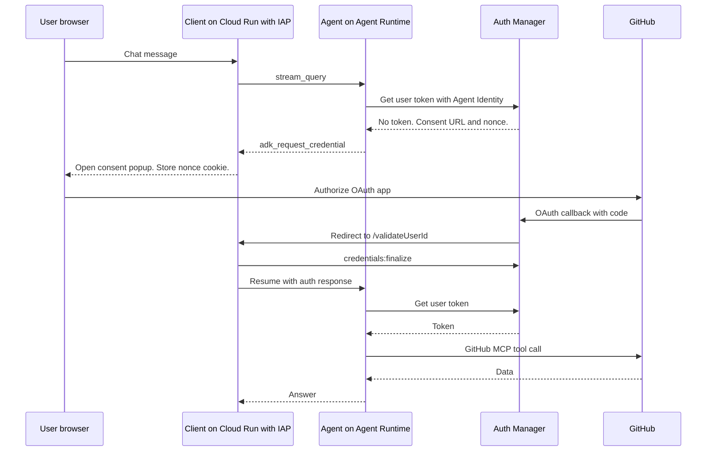

# Agent Identity and Auth Manager demos

These demos show how an ADK agent on Agent Runtime gets credentials for
other services. The agent uses its own Agent Identity for Google Cloud. It uses
Auth Manager to get third-party credentials, with or without a user.

## Sub-demos

| Sub-demo | What it shows | Status |
|---|---|---|
| [3lo_github](./3lo_github/) | The agent reads GitHub with the token of the signed-in user. Auth Manager runs the 3-legged OAuth (3LO) consent flow and stores the token. | Tested |
| `2lo_client_credentials` | The agent calls an API with its own OAuth client credentials (2LO). No user consent. | Planned |
| `api_key` | The agent calls an API with an API key that Auth Manager stores. | Planned |
| `outbound_bindings` | Limits on which auth providers an agent can use. | Planned |
| `token_exchange_obo` | Token exchange to act on behalf of the user. | Planned |
| `dynamic_client_registration` | OAuth dynamic client registration for MCP servers. | Planned |
| `agent_to_aws` | The agent calls AWS with its Agent Identity. | Planned |
| `mcp_server_oauth` | The agent calls an MCP server that requires OAuth. | Planned |
| `negative_tests` | Requests that must fail: no IAM binding, wrong region, revoked token. | Planned |

Only `3lo_github` has a folder. The other rows are plans.

## Shared parts

| Folder | Holds |
|---|---|
| [client](./client/) | Sample UI client. It relays the consent request and finalizes the credential. |

## Architecture of 3lo_github

