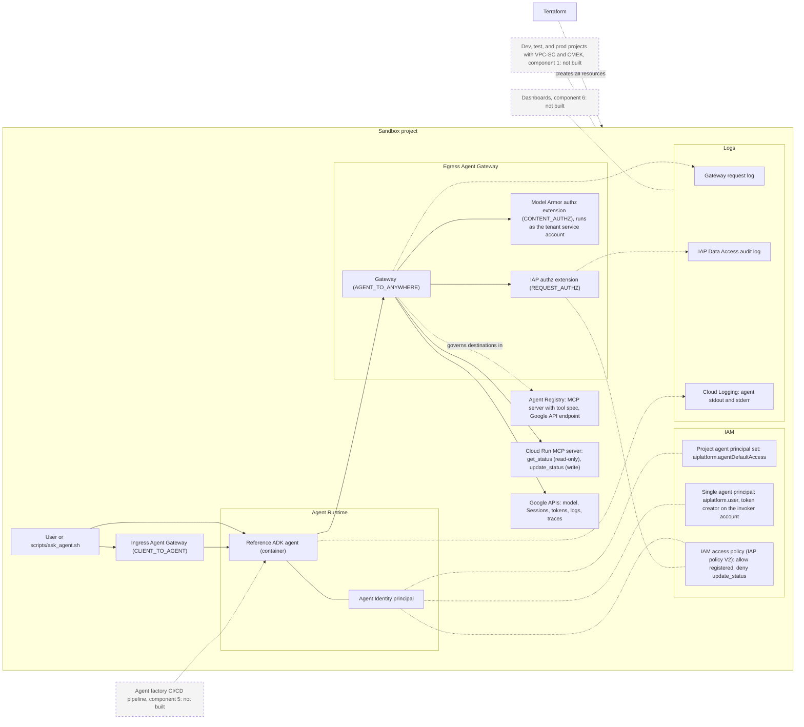
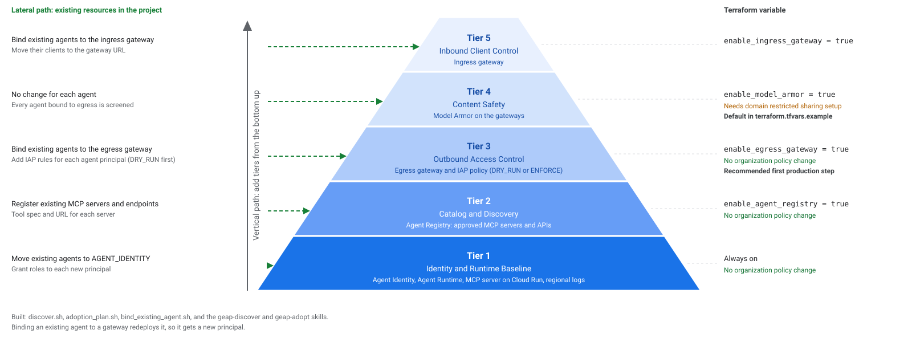
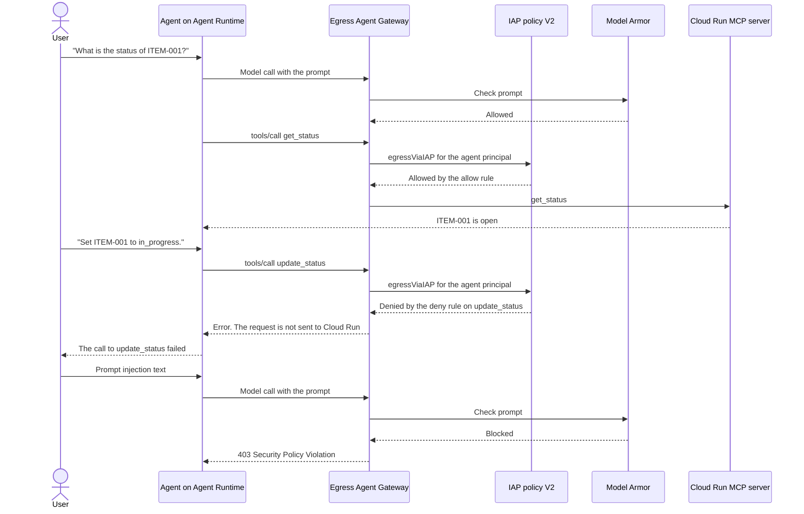

# Agent governance starter pack

> [!NOTE]
> Draft. The scope is a proposal. It is not agreed.

The agent governance starter pack is the governed platform on Gemini Enterprise Agent Platform
(GEAP) that a customer receives on handover day. Agents
from an agent factory run on it with the controls on: Agent Identity, Agent Registry, an egress
Agent Gateway, and audit logs.

This folder holds the **mini build**. The mini build proves the pattern in one new or existing
project. The product definition is in [conductor/product.md](conductor/product.md).

## What is in the starter pack

| Part | Contents |
|---|---|
| Terraform (`terraform/`) | Deploys everything. Four boolean variables turn the governance tiers on or off: `enable_agent_registry` (Agent Registry), `enable_egress_gateway` (egress Agent Gateway with IAP policy V2), `enable_model_armor` (Model Armor on the gateways), and `enable_ingress_gateway` (ingress Agent Gateway). `iap_enforcement_mode` sets the IAP policy to `DRY_RUN` or `ENFORCE` |
| 1 reference agent (`agent-template/`) | An ADK agent that runs on Agent Runtime with its own Agent Identity principal. It is deployed as a container so it trusts the egress gateway certificate |
| 1 MCP server (`mcp-server/`) | A sample Go MCP server on Cloud Run with one read-only tool (`get_status`) and one write tool (`update_status`). The IAP policy allows the read tool and denies the write tool |
| Policies (`policies/`) | The IAP access policy (`iap_access_policy.yaml`), multi-agent IAP policy example (`multi_agent_iap_policy.example.yaml`), Model Armor settings (`model_armor.yaml`), Principal Access Boundary example (`principal_access_boundary.example.yaml`), and Cloud Monitoring dashboard (`geap_dashboard.json`) |
| 19 scripts (`scripts/`) | `configure.sh`, `preflight.sh`, `package_agent.sh`, `deploy_checks.sh`, `check_tool_policy.sh`, `check_promotion.sh`, `ask_agent.sh`, `read_audit_log.sh`, `discover.sh`, `adoption_plan.sh`, `bind_existing_agent.sh`, `doctor.sh`, `onboard_agent.sh`, `install_harness.sh`, `teardown_plan.sh`, `cleanup.sh`, `quarantine_agent.sh`, `init_remote_state.sh`, and `agy_guard.sh` |
| 6 runbooks (`runbooks/`) | `add_agent.md`, `add_agents_cli_agent.md`, `switch_policy_mode.md`, `teardown.md`, `handover_checklist.md`, and `principal_access_boundary.md` |
| 2 CI templates (`pipelines/`) | `github-actions-pr-check.yaml` and `cloudbuild-pr-check.yaml` |
| Agent harness (`AGENTS.md`, `.agents/hooks.json`, `.agents/skills/`) | Safety rules, permission gates (`scripts/agy_guard.sh`), and 10 skills (`geap-discover`, `geap-adopt`, `geap-configure`, `geap-preflight`, `geap-deploy`, `geap-verify`, `geap-doctor`, `geap-onboard-agent`, `geap-reset`, `geap-teardown`) so a coding agent can run the steps above. A person must approve every `terraform apply` and every clean-up |
| Claude Code harness (`CLAUDE.md`, `.claude/settings.json`, `.claude/skills`) | `CLAUDE.md` imports `AGENTS.md`. `.claude/settings.json` holds the allow, ask, and deny lists. `.claude/skills` is a symlink to `.agents/skills`, so both harnesses use one copy of the 10 skills. See [GUIDE.md](GUIDE.md) Section 1 |
| Day-2 pack (`day2/`) | Built in `scripts/`, `policies/`, `pipelines/`, and `runbooks/`: posture check (`doctor.sh`), promotion readiness (`check_promotion.sh`), agent onboarding (`onboard_agent.sh`), tool policy check (`check_tool_policy.sh`), emergency quarantine (`quarantine_agent.sh`), Principal Access Boundary (`principal_access_boundary.example.yaml`), governance dashboard (`geap_dashboard.json`), CI checks (`pipelines/`), and remote Terraform state (`init_remote_state.sh`). See [day2/README.md](day2/README.md) |

The skill names (`geap-*`) and the default resource prefix (`name_prefix = "geap"`) keep the short
platform name, so existing deployments keep their resource names.

**Start here:** [GUIDE.md](GUIDE.md) is the step-by-step guide from a new or existing project to a
working mini build, with the known problems and their fixes.

## How it works

Terraform creates every resource in the diagram. The agent calls tools and Google APIs only through
the egress Agent Gateway. The gateway asks IAP and Model Armor for a decision on each call.



Legend: solid border = built in the mini build. Dashed border = not built.

## Governance tiers

You can turn each governance layer on or off with a boolean variable in `terraform/terraform.tfvars`.
Each tier adds one control on top of the tiers below it. [GUIDE.md](GUIDE.md#choose-your-tier) shows the
variable values for each tier.



The pyramid shows two paths. The vertical path adds one control for each tier. The lateral path (left, built with `geap-discover`, `geap-adopt`, `existing_mcp_servers`, `existing_agent_principals`, and `scripts/bind_existing_agent.sh`) brings the agents, MCP servers, and clients that already exist in the project under the same control. See the [lateral paths track](conductor/tracks/existing_project_adoption_20261109/index.md).


| Tier | Name | GEAP Services | Terraform Variable | Key Behavior |
|---|---|---|---|---|
| **Tier 1** | **Identity and Runtime Baseline** | Agent Runtime (`AGENT_IDENTITY` and Sessions), Cloud Run MCP server, regional Cloud Logging bucket | *(Always on)* | Every agent gets a unique SPIFFE identity and calls the MCP server with Cloud Run IAM (`roles/run.invoker`). Needs no organization policy changes |
| **Tier 2** | **Catalog and Discovery** | Agent Registry (`mcpServers` and `endpoints`) | `enable_agent_registry` (default `true`) | Registers the MCP server tool specification and the platform API endpoints in Agent Registry |
| **Tier 3** | **Outbound Access Control (Egress IAP)** | Egress Agent Gateway (`AGENT_TO_ANYWHERE`) and IAP Policy V2 (`REQUEST_AUTHZ` in `DRY_RUN` or `ENFORCE`) | `enable_egress_gateway` (default `true`) | Enforces per-tool CEL rules (`destination.agent_registry.mcp_server.tool.name`) on outbound agent traffic. Needs no domain restriction exception when `enable_model_armor = false` |
| **Tier 4** | **Content Safety (Model Armor)** | Model Armor templates, `CONTENT_AUTHZ` extension, and 3 `gcp-sa-dep` IAM grants | `enable_model_armor` (default `true`) | Screens prompts and tool outputs for prompt injection, jailbreaks, and sensitive data on active gateways. **Only Tier 4 can need the domain restriction setup, when the organization enforces it** |
| **Tier 5** | **Inbound Client Control (Ingress Gateway)** | Ingress Agent Gateway (`CLIENT_TO_AGENT`) and `clientToAgentConfig` (attaches Model Armor when `enable_model_armor = true`) | `enable_ingress_gateway` (default `false`) | Controls inbound client traffic to the agent |

The request flow below is in `ENFORCE` mode. The denied call never gets to Cloud Run.



## Layout

| Folder | What it holds | Component |
|---|---|---|
| [`terraform/`](terraform/) | APIs, audit logs, IAM, Cloud Run, Agent Registry, Agent Gateway, Model Armor, the agent | 1, 2, 3, 4 |
| [`agent-template/`](agent-template/) | The ADK reference agent | 4 |
| [`mcp-server/`](mcp-server/) | A sample MCP server in Go, with one read-only tool and one write tool | 3 |
| [`policies/`](policies/) | IAP access policies, Model Armor settings, Principal Access Boundary example, and Cloud Monitoring dashboard | 3, 6 |
| [`pipelines/`](pipelines/) | GitHub Actions and Cloud Build pull request check templates | 5 |
| [`runbooks/`](runbooks/) | Add a new ADK or `agents-cli` agent. Switch policy mode and reset state. Tear down the starter pack. Handover checklist. Principal Access Boundary | 6 |
| [`scripts/`](scripts/) | 19 scripts: preflight, configure, offline deploy checks, tool policy check, promotion check, discovery, lateral adoption plan, bind existing agent, doctor, onboard agent, install harness, quarantine agent, init remote state, package agent, ask agent, read audit log, teardown plan, cleanup, and `agy` guard hook | 6 |
| [`.agents/skills/`](.agents/skills/) | 10 CLI skills (`geap-discover`, `geap-adopt`, `geap-configure`, `geap-preflight`, `geap-deploy`, `geap-verify`, `geap-doctor`, `geap-onboard-agent`, `geap-reset`, `geap-teardown`), [`AGENTS.md`](AGENTS.md), and [`.agents/hooks.json`](.agents/hooks.json) with `scripts/agy_guard.sh` | 6 |
| [`day2/`](day2/) | Day-2 operational tool index and design rules | 6 |

## Related folders

These are links only. The starter pack does not use code from them.

- [`agent_auth`](../agent_auth/): the identity baseline and the 3LO auth provider pattern.
- [`curated_codelabs/agent-gateway-governance`](../curated_codelabs/agent-gateway-governance/): the
  egress gateway codelab with IAP policy V1.

## agents-cli and the starter pack

The starter pack does not use agents-cli. Terraform deploys the reference agent with
`google_vertex_ai_reasoning_engine`: a source archive from `scripts/package_agent.sh`, a
container built from `agent-template/Dockerfile` (`adk api_server`), `AGENT_IDENTITY`, and the
class methods in `terraform/adk_class_methods.json`.

| Job | Tool | Reason |
|---|---|---|
| Gateways, IAP access policy, Model Armor, Agent Registry, IAM | Terraform | agents-cli cannot create or manage gateways. The security owner owns these resources |
| Bind an agent to a gateway | Terraform | The security owner controls which gateway each agent uses |
| Deploy the reference agent | Terraform | `agents-cli deploy` builds a container with no class methods, so `:query` and `:streamQuery` do not work |
| Agent developer work: scaffold, local run, evaluation | agents-cli is an option | This is agent code, not platform. It belongs to component 5 (pipeline), which is not built |

An agent that agents-cli deploys can use the starter pack gateways with
`--agent-gateway-egress` or `--agent-gateway-ingress`. Follow
[`runbooks/add_agents_cli_agent.md`](runbooks/add_agents_cli_agent.md).

## Deploy the mini build

Prerequisites: a new or existing Google Cloud project with billing, `gcloud`, Terraform 1.9 or
later, and the Owner role on the project. All resources use `var.name_prefix` (default `geap`),
all APIs set `disable_on_destroy = false`, and `scripts/cleanup.sh` removes only `<name_prefix>-*`
resources by default ([runbooks/teardown.md](runbooks/teardown.md)). The mini build uses `us-central1`.

```bash
cd agent_governance_starter_pack
cp terraform/terraform.tfvars.example terraform/terraform.tfvars
# Edit terraform/terraform.tfvars: project_id, project_number, and organization_id.

gcloud auth application-default login
scripts/package_agent.sh

cd terraform
terraform init
terraform fmt -check -recursive && terraform validate && terraform test
terraform plan -out=tfplan
terraform apply tfplan
```

### Known prerequisite: domain restricted sharing

The gateway calls Model Armor as its Service Extensions service account. That account is in a
Google-managed tenant project. Terraform gives it 3 roles: `roles/modelarmor.calloutUser`,
`roles/modelarmor.user`, and `roles/serviceusage.serviceUsageConsumer`. If the organization enforces
`iam.allowedPolicyMemberDomains`, these 3 grants fail with "not in permitted organization". Without
them, Model Armor does not scan the gateway traffic.

The organization admin must choose one option before the apply:

| Approach | Use |
|---|---|
| Approach 1: managed constraint `iam.managed.allowedPolicyMembers`, with `allowedMemberSubjects` that names `serviceAccount:service-TENANT_PROJECT_NUMBER@gcp-sa-dep.iam.gserviceaccount.com` and `allowedPrincipalSets` that names `//cloudresourcemanager.googleapis.com/organizations/ORG_ID` | Production choice. Google Cloud checks `iam.allowedPolicyMemberDomains` and `iam.managed.allowedPolicyMembers` separately. If the organization enforces `iam.allowedPolicyMemberDomains`, the project must also relax `iam.allowedPolicyMemberDomains` (or the organization must replace it with `iam.managed.allowedPolicyMembers`) |
| Approach 2: short-lived project exception. Set `allow_google_managed_members = true`, apply the org policy and the 3 grants with `-target`, then set it to `false` and apply again. The grants remain | Used when you cannot keep a project-level override on `iam.allowedPolicyMemberDomains` |
| Approach 3: project-level `allowAll` (`allow_google_managed_members = true` in this Terraform) | Sandbox only |

If you want to deploy without the `gcp-sa-dep` Model Armor grants, set `enable_model_armor = false` (Tiers 1 to 3) or set `enable_egress_gateway = false` and `enable_ingress_gateway = false` (Tiers 1 and 2) in `terraform/terraform.tfvars`.

## Check the controls after deployment

Start with `iap_enforcement_mode = "DRY_RUN"`. [switch_policy_mode.md](runbooks/switch_policy_mode.md)
moves the policy between `DRY_RUN` and `ENFORCE`.

| Control | What to check | Command or page |
|---|---|---|
| **Identity** | The agent has its own Agent Identity principal. Tool access, Sessions, and the IAP policy apply to this single principal. Start-up base roles go to the project agent principal set. There is no project-level token creator role | `terraform output agent_principal`. IAM page of the project |
| **Catalog** | The MCP server and the Google API endpoints are in Agent Registry. The tool spec marks `get_status` as read-only | Agent Registry page. [`tool_spec.json`](mcp-server/tool_spec.json) |
| **Gateway control** | In `DRY_RUN`, the request "Set ITEM-003 to closed" passes. After the change to `ENFORCE` and a 3-minute wait, the same request is denied. The agent can report "MCP session connection lost", not a clear `403` | `scripts/ask_agent.sh "Set ITEM-003 to closed"`. [`policies/iap_access_policy.yaml`](policies/iap_access_policy.yaml) |
| **Audit** | Use the evidence that exists: the agent error for `update_status`, and no matching request in the Cloud Run request log | Agent reply. `gcloud logging read` on `run.googleapis.com/requests`. `scripts/read_audit_log.sh 15m` for the logs that do appear |

The change to `ENFORCE` takes about 2 minutes to apply, and the gateway uses it 1 to 3 minutes
later.

> [!WARNING]
> Known gap (08 Nov 2026 test, IAP policy V2): the IAP Data Access audit log had entries only for
> MCP base methods (`initialize`, `notifications/initialized`). It had no entry for the `tools/call`
> decisions, including the enforced denial. The gateway request log also had no entry for the
> denied call. Until this gap is solved, use the agent reply as the evidence of a denial.

## Clean up

To remove all starter pack resources from the project, run:

```bash
scripts/cleanup.sh
```

The script runs `terraform destroy`, then removes the `<name_prefix>-*` resources that are not in the
Terraform state. Three project-wide steps run only with `--include-project-wide`. The APIs stay on.
[runbooks/teardown.md](runbooks/teardown.md) lists what the script deletes and what it keeps.
