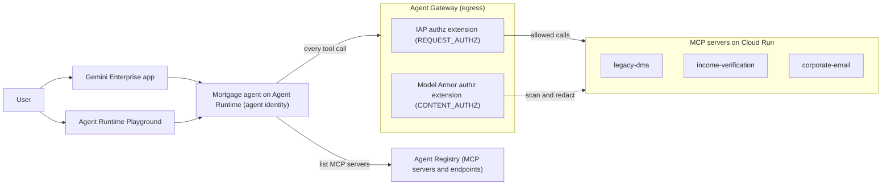
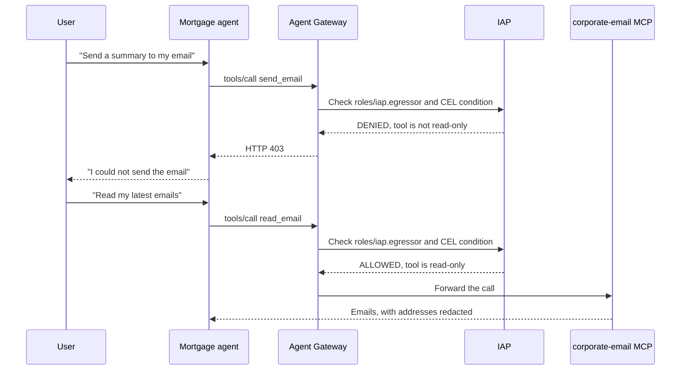

# Agent Gateway governance demo (IAP + Model Armor)

A ready-to-reuse demo of **Agent Gateway** on Google Cloud. An ADK agent on Agent Runtime calls
three MCP servers on Cloud Run. Every outbound call goes through Agent Gateway, which checks
identity with IAP and content with Model Armor.

This folder does not hold the demo code. It holds the notes that you need to run the public
codelab again, fast, and to present it.

| Item | Link |
|---|---|
| Codelab | [Governing agentic workloads with Agent Gateway](https://codelabs.developers.google.com/cloudnet-agent-gateway) |
| Sample code | [GoogleCloudPlatform/cloud-networking-solutions, `demos/agent-gateway`](https://github.com/GoogleCloudPlatform/cloud-networking-solutions/tree/main/demos/agent-gateway) |
| Last full run | October 2026, region `us-central1` |

## What the demo shows

| Control | What the audience sees |
|---|---|
| Agent identity | The agent has its own identity. IAM grants go to the agent, not to a service account. |
| Agent Registry | The agent finds its MCP servers at runtime from the registry. The gateway blocks hosts that are not in the registry. |
| IAP egress policy (`REQUEST_AUTHZ`) | `roles/iap.egressor` on each MCP server. A CEL condition allows read-only tools and blocks write tools. |
| Model Armor (`CONTENT_AUTHZ`) | Prompt injection checks and redaction of sensitive data, such as SSNs, in tool responses. |
| Observability | Gateway request logs show the tool name and the allow or deny result for each call. |

## Architecture

## Flow of one tool call

The follow-up prompt asks the agent to email a summary. `send_email` is a write tool, so IAP
blocks it.

## Files in this folder

| File | Use it for |
|---|---|
| [RUNBOOK.md](RUNBOOK.md) | Deploy the demo from zero. Includes the fixes for the problems that the codelab does not mention. |
| [TALKING_POINTS.md](TALKING_POINTS.md) | Present the demo: script, prompts, expected results, and audience questions. |

## Time and cost

| Item | Value |
|---|---|
| Deploy time | About 90 minutes, with the fixes in the runbook |
| Always-on cost | 3 Cloud Run services with 1 minimum instance each, and the agent with 2 minimum instances (4 vCPU, 8 GiB) |
| Clean up | Delete the agent first, then run `terraform destroy`. See the runbook. |

> [!WARNING]
> The demo costs money every hour while it runs. Delete it when you finish.
