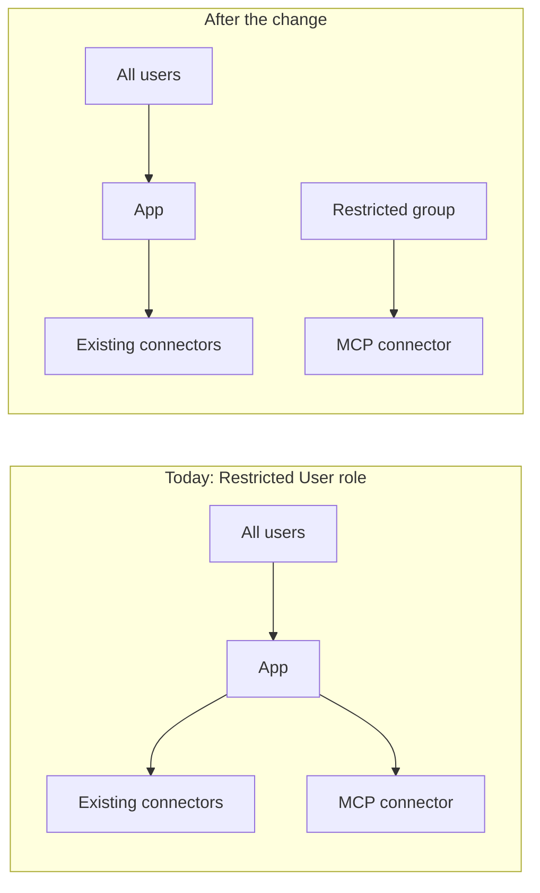
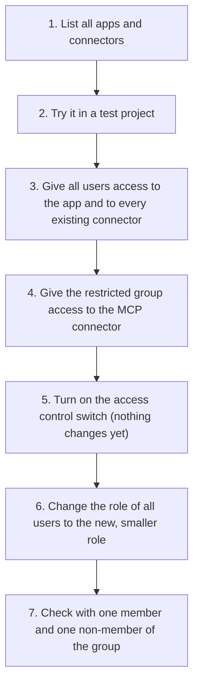
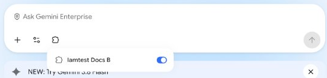
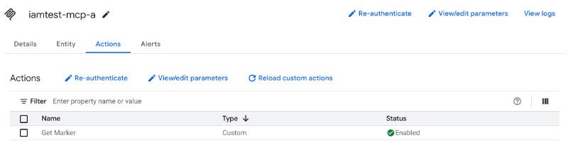

# Show a Custom MCP Connector to One Group Only (Classic Gemini Enterprise)

This page answers one question: can you show a custom MCP connector to one group of users, and
hide it from everybody else, in the same Gemini Enterprise app?

The answer comes from a live test on 17 Nov 2026. Part 1 is for everybody. Part 2 is for the
admin who makes the change. Parts 3 and 4 are for engineers.

## Contents

- [Part 1. What this means for you](#part-1-what-this-means-for-you)
- [Part 2. For your admin](#part-2-for-your-admin)
- [Part 3. Test results](#part-3-test-results)
- [Part 4. For engineers: repeat the test](#part-4-for-engineers-repeat-the-test)
- [Lessons](#lessons)
- [Limits](#limits)
- [Sources](#sources)

## Part 1. What this means for you

### 1.1 In short

- **Yes, you can.** One app can show the MCP connector to one group and hide it from all other
  users.
- **It does not work today.** Your users have the **Restricted User** role. That role lets every
  user see every connector, so the access control switch hides nothing.
- **What to change:** give users a new, smaller role that lets them sign in but not see
  connectors. Then give each group access to the connectors that it needs.

### 1.2 When is the MCP connector hidden?

Three settings decide if a user sees the MCP connector. Read the table from left to right. All
rows assume that the user has access to the app.

| Access control switch | User's role on the project | User has access to the MCP connector | Does the user see the MCP connector? |
|---|---|---|---|
| Off | Any role | Yes or no | **Yes** |
| On | Restricted User (the role your users have today) | Yes or no | **Yes**. The switch has no effect. |
| On | New, smaller role | Yes | **Yes** |
| On | New, smaller role | No | **No. The connector is hidden.** |

**Why the Restricted User role has this effect:** this role already gives access to every
connector in the project. So the switch has nothing to block. The new, smaller role gives no
connector access. With that role, a user sees a connector only after you give access to that
connector.

### 1.3 Who sees what



- **Today:** all users see all connectors, also after you turn on the access control switch.
- **After the change:** all users still see the existing connectors. Only the restricted group
  sees the MCP connector.

### 1.4 Does the switch affect my other connectors?

- **The switch alone: no.** While users have the Restricted User role, the switch changes nothing
  for anybody.
- **The role change: yes.** After you give users the new, smaller role, each user sees only the
  connectors that the user has access to. A connector without access disappears for that user.
- **So:** give access to all existing connectors first. Change the role last.

### 1.5 Safe order



Step 6 is the step that hides the MCP connector. In the test, it took about 5 minutes. Users must
refresh the web page after the change.

### 1.6 Checklist

- [ ] All users and the restricted group are Google groups.
- [ ] Every existing connector has access for all users before step 6.
- [ ] Admins know that they still see everything (see [2.3](#23-roles-that-cancel-the-control)).
- [ ] Users know to refresh the web page after the change.
- [ ] You know how to undo the change: give users the Restricted User role again.

## Part 2. For your admin

Each statement has a tag. **[Tested]** means that the 17 Nov 2026 test showed it.
**[Documented]** means that the public documentation states it. **[Inference]** means that it
follows from the test and the documentation, but the test did not show it directly.

### 2.1 Roles

| Name in Part 1 | Exact role | Where to give it |
|---|---|---|
| Restricted User role (today) | `roles/discoveryengine.agentspaceRestrictedUser` | Project. Remove it in step 6. |
| New, smaller role | Custom role `customRestrictedEndUser` with only `discoveryengine.devToolsConfigs.get` and `discoveryengine.locations.buildAuthorizationUrl` | Project |
| Access to an app or a connector | `roles/discoveryengine.agentspaceUser` (Gemini Enterprise User) | The app, and each connector |

**Why the Restricted User role hides nothing:** it holds `discoveryengine.dataStores.get` and
`discoveryengine.collections.get` on the whole project. So the connector-level check always
passes. **[Tested]**

### 2.2 Detailed steps

| Step | Action | Effect for users |
|---|---|---|
| 1 | List every app and every connector in the project. The console switch applies to every multi-region where the project is configured. The REST call applies to one multi-region for each call. | None **[Documented]** |
| 2 | Do the test in a separate project first, with the scripts in [Part 4](#part-4-for-engineers-repeat-the-test). | None |
| 3 | Give `agentspaceUser` to the all-users group on the app and on every existing connector. For a connector with several parts (entities), give the role on the connector collection and on every entity data store. | None |
| 4 | Give `agentspaceUser` on the MCP connector to the restricted group only: on its collection and on its `_mcp_data` data store. | None |
| 5 | Create the custom role `customRestrictedEndUser`. Turn on the access control switch. | None. The Restricted User role is still in place. **[Tested]** |
| 6 | Change the project role of the all-users group from `agentspaceRestrictedUser` to `customRestrictedEndUser`. | The MCP connector is hidden for non-members after about 5 minutes. **[Tested for one user, not for a group]** |
| 7 | Check with one member and one non-member of the restricted group. Users refresh the web page. | None |
| Undo | Change the project role back to `agentspaceRestrictedUser`. | Expected to restore all connectors. **[Inference, not timed]** |

> [!NOTE]
> The documentation lets you add a user or a group on the app and on the data store.
> **[Documented]** The test gave roles to one user directly. It did not test a group.

### 2.3 Roles that cancel the control

The control does not hide a connector from a user who has one of these roles on the project. This
applies to a direct grant and to a grant to a group that the user is in.

- Any predefined Discovery Engine role, for example `agentspaceRestrictedUser`,
  `agentspaceUser`, or `agentspaceAdmin`. **[Documented]**
- Owner (`roles/owner`), Editor (`roles/editor`), or Viewer (`roles/viewer`). These basic roles
  include `discoveryengine.dataStores.get` and `discoveryengine.collections.get`.
  **[Verified from the role permissions, not tested in the web app]**

The test showed the effect for `agentspaceRestrictedUser` only. **[Tested]** Admins with one of
these roles keep access to all connectors.

### 2.4 Reminders

- After you create an MCP connector, open the data store, click **Actions** > **Reload custom
  actions**, and enable each tool. Until then, Gemini Enterprise does not use the tool.
  **[Tested]**
- Refresh the web page after a change. An open page can show an old connector list. **[Tested]**
  The documentation also says to sign out and sign in again, or to use a private window, after an
  IAM change. **[Documented]**
- Wait about 5 minutes after you turn on the switch or change the role. **[Documented, Tested]**
- The organization policy constraint `discoveryengine.managed.disableCustomMcpServerConnector`
  can block MCP connectors. Check it before you start. **[Tested]**

## Part 3. Test results

Test on 17 Nov 2026, classic Gemini Enterprise, location `global`. The test user had no other
roles in the project. Connector A is an MCP connector. Its tool returns the text `MCP-MARKER-A`.
Connector B is a Cloud Storage connector. Its files hold the text `DOC-MARKER-B`.

| Round | Project role of the test user | Access given | Switch | Connector A (MCP) | Connector B |
|---|---|---|---|---|---|
| Baseline | Restricted User | App | Off | Visible, tool used | Visible |
| 1 | Restricted User | App | On | **No change.** Tool used. | Visible |
| 2 | New, smaller role | App, connector B | On | **Hidden** after about 5 minutes. Tool not used. | Visible |
| 3 | New, smaller role | App, connector B, connector A | On | **Back** about 1 minute after access was given. Tool used. | Visible |

Evidence for each round:

- The answer in the web app (with or without the marker text).
- The MCP server log line `TOOL_CALL get_marker` for each tool call. In round 2, the log had no
  entries after the role change.
- The connector menu in a new chat after a page refresh. In round 2, only connector B was listed.

Round 1 was checked 16 minutes after the switch was turned on. Round 2 changed only the project
role, and it took effect. So the switch was active in round 1, and the Restricted User role caused
the result.

### 3.1 Screenshots

Baseline and round 1: the test user sees both connectors.


Round 2: after a page refresh, the connector menu shows only connector B.



Round 2: the answer has no connector A marker. Only connector B results come back.


Round 3: after access to connector A was given, the tool runs and the answer has `MCP-MARKER-A`.


Setup: the manual step. The tool shows as **Enabled** on the **Actions** tab of the MCP connector.



## Part 4. For engineers: repeat the test

### 4.1 Requirements

- A Google Cloud project with classic Gemini Enterprise (`experienceState` = `LEGACY_ONLY`).
- An admin account with Owner, or with the Discovery Engine admin, IAM admin, Cloud Run admin,
  and Storage admin roles.
- A test user with a Gemini Enterprise license and no project-level roles.
- `gcloud`, `curl`, `jq`, and `bash`. Go 1.25 or later to build the MCP server locally.

### 4.2 Configure

```bash
cp .env.example .env
# Edit .env. Set PROJECT_ID, PROJECT_NUMBER, TEST_USER, and BUCKET.
gcloud auth login
```

### 4.3 Run

Run the scripts in this order. Each script prints what it did.

| Step | Script | Action |
|---|---|---|
| 1 | `./00_preflight.sh` | Read-only checks: `experienceState`, switch, organization policies, project roles of the test user. |
| 2 | `./10_deploy_mcp_server.sh` | Deploy the MCP server to Cloud Run. Print the `/mcp` URL. |
| 3 | `./20_create_docs_datastore.sh` | Create connector B and import two files. |
| 4 | `./30_create_mcp_connector.sh` | Create connector A with `setUpDataConnectorV2`. Then do the manual step that the script prints. |
| 5 | `./40_create_app.sh` | Create the app with both data stores. Print the web app URL. |
| 6 | `./60_round1_grants.sh` | Give the test user `agentspaceRestrictedUser` (project) and `agentspaceUser` (app). |
| 7 | Web app, as the test user | Baseline: ask for the connector A marker and the connector B marker. Expect both. |
| 8 | `./50_toggle.sh on` | Turn on the switch. |
| 9 | Web app, as the test user | Round 1: refresh the page, open a new chat, ask again. Expect both markers. |
| 10 | `./70_round2_grants.sh` | Create the custom role, change the project role, give access to connector B only. |
| 11 | Web app, as the test user | Round 2, after about 5 minutes: refresh, new chat, ask again. Expect `DOC-MARKER-B` only. |
| 12 | `./80_grant_connector_a.sh` | Give access to connector A (collection and data store). |
| 13 | Web app, as the test user | Round 3, after about 1 minute: refresh, new chat, ask again. Expect both markers. |
| 14 | `./99_cleanup.sh` | Remove all test resources and grants. |

Example questions for the web app:

- "What is the connector A marker? Use the MCP tool."
- "What is the connector B marker?"

Check the tool calls in the Cloud Run logs:

```bash
gcloud logging read \
  'resource.type="cloud_run_revision" AND textPayload:"TOOL_CALL get_marker"' \
  --project="$PROJECT_ID" --freshness=1h --format='value(timestamp,textPayload)'
```

### 4.4 Test the MCP server locally

```bash
cd mcp_server
go build -o iamtest-mcp .
PORT=8080 ./iamtest-mcp &

H=(-H 'Content-Type: application/json' -H 'Accept: application/json, text/event-stream')
curl -s "${H[@]}" localhost:8080/mcp -d '{"jsonrpc":"2.0","id":1,"method":"initialize","params":{"protocolVersion":"2025-06-18","capabilities":{},"clientInfo":{"name":"curl","version":"1"}}}'
curl -s "${H[@]}" localhost:8080/mcp -d '{"jsonrpc":"2.0","id":2,"method":"tools/list"}'
curl -s "${H[@]}" localhost:8080/mcp -d '{"jsonrpc":"2.0","id":3,"method":"tools/call","params":{"name":"get_marker","arguments":{}}}'
```

The last call returns `MCP-MARKER-A`. The server is stateless, so no session header is necessary.

### 4.5 Files

| File | Purpose |
|---|---|
| `lib.sh` | Shared functions: `.env`, access token, REST calls, IAM read-modify-write that keeps existing bindings. |
| `mcp_server/main.go` | MCP server with one tool, `get_marker`. Streamable HTTP at `/mcp`. |
| `mcp_server/Dockerfile` | Multi-stage build. Final image `gcr.io/distroless/static`. |
| `.env.example` | Settings with placeholder values. |

## Lessons

- **MCP tools are off by default.** After an API setup, open the data store, click **Reload
  custom actions**, and enable each tool. Until then, Gemini Enterprise does not call the MCP
  server. The `PATCH` on `actionConfig` sets `actionState` to `ACTIVE`, but it does not enable a
  tool.
- **Create the app with all data stores in one call.** An app that was created with one data
  store cannot get more data stores later. The API returns `FAILED_PRECONDITION`.
- **Refresh the web page after a change.** An open page can show an old connector list. A new
  chat after a refresh shows the correct list.
- **Check the organization policy first.** The managed constraint
  `discoveryengine.managed.disableCustomMcpServerConnector` can block the creation of an MCP
  connector.
- **Python MCP servers:** version 2 of the `mcp` Python SDK removed the `mcp.server.fastmcp`
  module. If you write the server in Python, pin `mcp<2` or use the new API.

## Limits

- The test covers classic Gemini Enterprise only. It does not cover the new Gemini Enterprise
  experience.
- The test ran on 17 Nov 2026 in the `global` location. The behaviour can change.
- The test used one test user with direct grants. It did not test Google groups.
- The test did not time the undo step.

## Sources

- [Configure access controls for apps and data stores](https://docs.cloud.google.com/gemini/enterprise/docs/iam-policy-for-apps-and-data-stores)
- [Configure access controls for apps](https://docs.cloud.google.com/gemini/enterprise/docs/iam-policy-for-apps)
- [Set up a custom MCP server connector](https://docs.cloud.google.com/gemini/enterprise/docs/connectors/custom-mcp-server/set-up-custom-mcp-server)
- [Method: projects.locations.setUpDataConnectorV2](https://docs.cloud.google.com/gemini/enterprise/docs/reference/rest/v1alpha/projects.locations/setUpDataConnectorV2)
- [Configure allowed data sources](https://docs.cloud.google.com/gemini/enterprise/docs/connectors/configure-allowed-data-sources)
- [Go MCP SDK](https://github.com/modelcontextprotocol/go-sdk)
