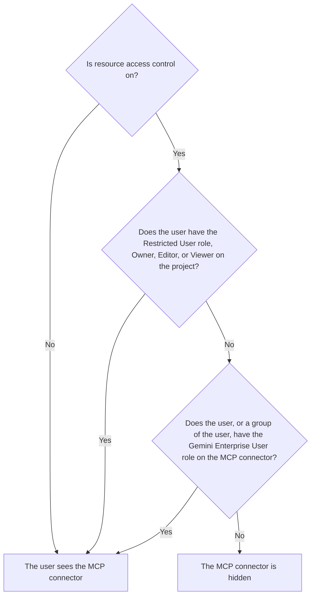
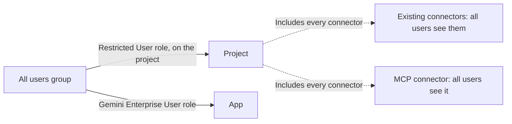
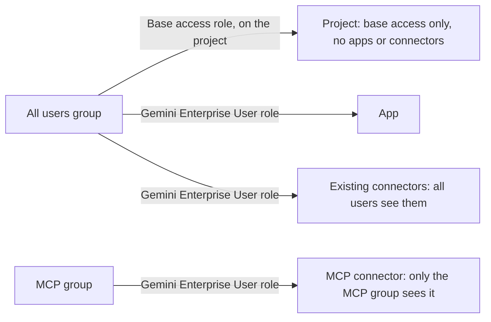
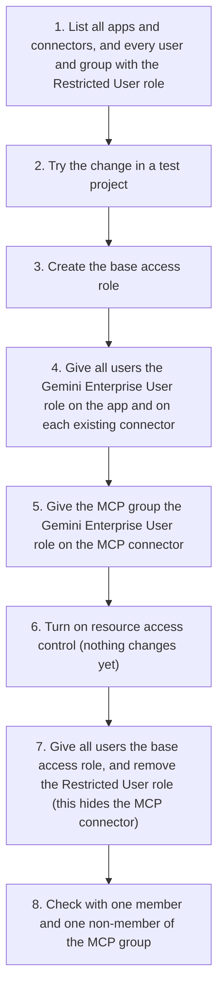
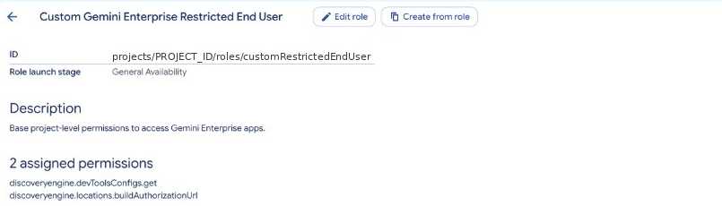
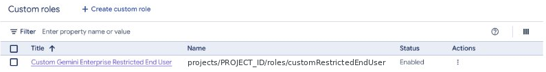
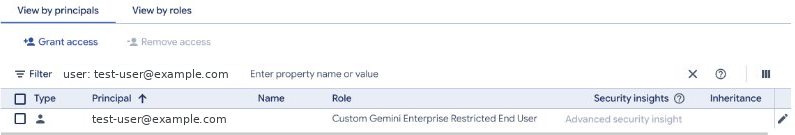
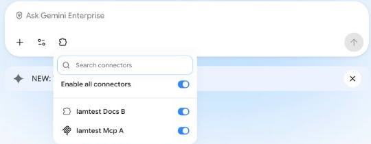
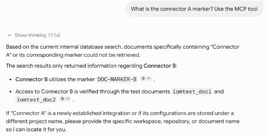
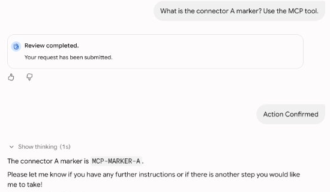

# Show a Custom MCP Connector to One Group Only (Classic Gemini Enterprise)

This page answers one question: can you show a custom MCP connector to one group of users, and
hide it from all other users, in the same Gemini Enterprise app?

The answer comes from a live test on 17 Nov 2026.

| Part | For | Content |
|---|---|---|
| [Key terms](#key-terms) | Everybody | The setting and the three roles that this page uses |
| [Part 1](#part-1-what-this-means-for-you) | Everybody | The answer, with tables and diagrams |
| [Part 2](#part-2-for-your-admin) | The admin who makes the change | Exact steps and warnings |
| [Part 3](#part-3-test-results) | Engineers | Test results and screenshots |
| [Part 4](#part-4-for-engineers-repeat-the-test) | Engineers | Scripts to repeat the test |
| [Lessons](#lessons), [Limits](#limits), [Sources](#sources) | Everybody | What we learned, what we did not test, and the documentation |

## Key terms

| Term | What it is | Where you give it |
|---|---|---|
| **Resource access control** | A Gemini Enterprise setting. When it is on, Gemini Enterprise checks each user's access to each app and each connector. In the console: **Settings** > **Resource access control**. | Project |
| **Restricted User role** (`roles/discoveryengine.agentspaceRestrictedUser`) | A predefined role. Your users have it today. It includes read access to every connector in the project. | Project |
| **Base access role** (`customRestrictedEndUser`) | A custom role that you create. It has 2 permissions. It lets a user open the Gemini Enterprise web app. It gives no access to any app or connector. | Project |
| **Gemini Enterprise User role** (`roles/discoveryengine.agentspaceUser`) | A predefined role. On an app, it lets the user use the app. On a connector, it lets the user use the connector. | One app, or one connector |
| **Connector** | A data source in a Gemini Enterprise app, for example the MCP server. The documentation also calls it a data store. | — |

## Part 1. What this means for you

### 1.1 In short

| Question | Answer |
|---|---|
| Can one app show the MCP connector to one group only? | **Yes**, with resource access control on. |
| Does it work with the roles that your users have today? | **No.** The Restricted User role includes access to every connector. So resource access control hides nothing. |
| What must change? | Give everybody the base access role instead of the Restricted User role. Then give the Gemini Enterprise User role on each connector, only to the groups that must see it. |

### 1.2 How Gemini Enterprise decides



The same decision applies to each connector. All paths assume that the user can open the app.

| Resource access control | User's role on the project | Gemini Enterprise User role on the MCP connector | Does the user see the MCP connector? |
|---|---|---|---|
| Off | Any role | Yes or no | **Yes** |
| On | Restricted User role (today) | Yes or no | **Yes.** Resource access control has no effect. |
| On | Base access role | Yes | **Yes** |
| On | Base access role | No | **No. The connector is hidden.** |

### 1.3 Who sees what

A solid arrow is a role that you give. A dotted arrow shows what a project role already includes.

**Today (resource access control on or off)**



**After the change (resource access control on)**



The members of the MCP group are also in the all users group. They get the app and the existing
connectors from the all users group, and the MCP connector from the MCP group.

| Group | Role on the project | Gemini Enterprise User role on | Sees |
|---|---|---|---|
| All users | Base access role | The app, and each existing connector | The app and the existing connectors |
| MCP group (also in all users) | No extra role | The MCP connector | The app, the existing connectors, and the MCP connector |

### 1.4 Does the change affect my other connectors?

| Action | Effect on the other connectors |
|---|---|
| Turn on resource access control, while users keep the Restricted User role | **None.** Nothing changes for anybody. |
| Give users the base access role, and remove the Restricted User role | **Yes.** Each user sees only the connectors where the user (or a group of the user) has the Gemini Enterprise User role. A connector without that role disappears for that user. |

So give the Gemini Enterprise User role on every existing connector first. Change the project role
last.

> [!WARNING]
> Remove the Restricted User role from **every** user and group at project level. If one user
> keeps it, from a direct grant or through any group, that user still sees every connector.

### 1.5 Why not keep the Restricted User role for the MCP group?

It would work, because the roles of a user add up. But it gives too much access:

| | Recommended: Gemini Enterprise User role on the MCP connector | Not recommended: Restricted User role for the MCP group |
|---|---|---|
| The MCP group sees the MCP connector | Yes | Yes |
| The MCP group sees connectors that you add later for other groups | No | **Yes**, every connector in the project |
| You can see why a user has access | Yes, on the connector | Only from the project role |

The test did not try the "not recommended" setup. The result in the table is an inference.

### 1.6 Safe order



| Step | Effect for users | Time |
|---|---|---|
| 1 to 6 | None | — |
| 7 | Users outside the MCP group no longer see the MCP connector | About 5 minutes in the test |
| 8 | Users must refresh the web page to see the new connector list | — |
| Undo | Give the Restricted User role back. All connectors come back. | Not timed |

### 1.7 Checklist

- [ ] The all users group and the MCP group are Google groups.
- [ ] Every existing connector has the Gemini Enterprise User role for all users before step 7.
- [ ] No user or group keeps the Restricted User role at project level after step 7.
- [ ] Admins know that they still see every connector (see [2.3](#23-roles-that-cancel-the-control)).
- [ ] Users know to refresh the web page after the change.
- [ ] You know how to undo the change: give the Restricted User role back.

## Part 2. For your admin

Each statement has a tag. **[Tested]** means that the 17 Nov 2026 test showed it.
**[Documented]** means that the public documentation states it. **[Inference]** means that it
follows from the test and the documentation, but the test did not show it directly.

### 2.1 Exact roles and permissions

| Term | Exact role | Permissions that matter |
|---|---|---|
| Restricted User role | `roles/discoveryengine.agentspaceRestrictedUser` | Includes `discoveryengine.dataStores.get` and `discoveryengine.collections.get` on the whole project. So every connector-level check passes. **[Tested]** |
| Base access role | Custom role `customRestrictedEndUser` | Only `discoveryengine.devToolsConfigs.get` and `discoveryengine.locations.buildAuthorizationUrl`. The documentation says that these let the web app load the authorization endpoint and the developer tools settings, without access to apps or data stores. **[Documented]** |
| Gemini Enterprise User role | `roles/discoveryengine.agentspaceUser` | Gives use of one app, or one connector, when you give it on that resource. **[Tested]** |

The base access role in the console, with its 2 permissions:



### 2.2 Detailed steps

| Step | Action | Effect for users |
|---|---|---|
| 1 | List every app and every connector in the project. List every user and group that has `agentspaceRestrictedUser`, Owner, Editor, or Viewer at project level. | None |
| 2 | Do the change in a separate project first, with the scripts in [Part 4](#part-4-for-engineers-repeat-the-test). | None |
| 3 | Create the custom role `customRestrictedEndUser` with the 2 permissions in [2.1](#21-exact-roles-and-permissions). | None |
| 4 | Give `agentspaceUser` to the all users group on the app and on every existing connector. For a connector with several parts (entities), give the role on the connector collection and on every entity data store. | None |
| 5 | Give `agentspaceUser` to the MCP group on the MCP connector: on its collection and on its `_mcp_data` data store. | None |
| 6 | Turn on resource access control. The console setting applies to every multi-region where the project is configured. The REST call applies to one multi-region for each call. **[Documented]** | None, because users still have `agentspaceRestrictedUser`. **[Tested]** |
| 7 | Give `customRestrictedEndUser` to the all users group at project level. Remove `agentspaceRestrictedUser` from every user and group at project level. | Users outside the MCP group no longer see the MCP connector, after about 5 minutes. **[Tested for one user, not for a group]** |
| 8 | Check with one member and one non-member of the MCP group. Users refresh the web page. | None |
| Undo | Give `agentspaceRestrictedUser` back at project level. | Expected to restore all connectors. **[Inference, not timed]** |

Step 3: the base access role in **IAM & Admin** > **Roles** > **Custom**.



Step 7: in **IAM & Admin** > **IAM**, the user has only the base access role at project level. No
Restricted User role, Owner, Editor, or Viewer is left.



> [!NOTE]
> The documentation lets you give a role to a user or to a group on the app and on the data store.
> **[Documented]** The test gave roles to one user directly. It did not test a group.

### 2.3 Roles that cancel the control

Resource access control does not hide a connector from a user who has one of these roles at project
level. This applies to a direct grant and to a grant through a group.

| Role | Why | Status |
|---|---|---|
| Any predefined Discovery Engine role, for example `agentspaceRestrictedUser`, `agentspaceUser`, or `agentspaceAdmin` | Project-level predefined roles override resource-level roles | **[Documented]**. Tested for `agentspaceRestrictedUser`. |
| Owner (`roles/owner`), Editor (`roles/editor`), Viewer (`roles/viewer`) | These basic roles include `discoveryengine.dataStores.get` and `discoveryengine.collections.get` | **[Verified from the role permissions, not tested in the web app]** |

So admins with one of these roles keep access to every connector.

### 2.4 Reminders

| Reminder | Status |
|---|---|
| After you create an MCP connector, open the data store, click **Actions** > **Reload custom actions**, and enable each tool. Until then, Gemini Enterprise does not use the tool. | **[Tested]** |
| Refresh the web page after a change. An open page can show an old connector list. The documentation also says to sign out and sign in again, or to use a private window. | **[Tested, Documented]** |
| Wait about 5 minutes after you turn on resource access control or change a role. | **[Documented, Tested]** |
| The organization policy constraint `discoveryengine.managed.disableCustomMcpServerConnector` can block MCP connectors. Check it before you start. | **[Tested]** |

## Part 3. Test results

Test on 17 Nov 2026, classic Gemini Enterprise, location `global`. The test user had no other
roles in the project. Connector A is an MCP connector. Its tool returns the text `MCP-MARKER-A`.
Connector B is a Cloud Storage connector. Its files hold the text `DOC-MARKER-B`.

| Round | Test user's role on the project | Gemini Enterprise User role on | Resource access control | Connector A (MCP) | Connector B |
|---|---|---|---|---|---|
| Baseline | Restricted User role | App | Off | Visible, tool used | Visible |
| 1 | Restricted User role | App | On | **No change.** Tool used. | Visible |
| 2 | Base access role | App, connector B | On | **Hidden** after about 5 minutes. Tool not used. | Visible |
| 3 | Base access role | App, connector B, connector A | On | **Back** about 1 minute after the role was given. Tool used. | Visible |

Evidence for each round:

- The answer in the web app (with or without the marker text).
- The MCP server log line `TOOL_CALL get_marker` for each tool call. In round 2, the log had no
  entries after the role change.
- The connector menu in a new chat after a page refresh. In round 2, only connector B was listed.

Round 1 was checked 16 minutes after resource access control was turned on. Round 2 changed only
the project role, and it took effect. So resource access control was active in round 1, and the
Restricted User role caused the result.

### 3.1 Screenshots

Baseline and round 1: the test user sees both connectors.



Round 2: after a page refresh, the connector menu shows only connector B.


Round 2: the answer has no connector A marker. Only connector B results come back.



Round 3: after the Gemini Enterprise User role was given on connector A, the tool runs and the answer has `MCP-MARKER-A`.



Setup: the manual step. The tool shows as **Enabled** on the **Actions** tab of the MCP connector.


## Part 4. For engineers: repeat the test

### 4.1 Requirements

- A Google Cloud project with classic Gemini Enterprise (`experienceState` = `LEGACY_ONLY`).
- An admin account with Owner, or with the Discovery Engine admin, IAM admin, Cloud Run admin,
  and Storage admin roles.
- A test user with a Gemini Enterprise license and no project-level roles.
- `gcloud`, `curl`, `jq`, and `bash`. Go 1.25 or later to build the MCP server locally.

### 4.2 Configure

```bash
cp .env.example .env
# Edit .env. Set PROJECT_ID, PROJECT_NUMBER, TEST_USER, and BUCKET.
gcloud auth login
```

### 4.3 Run

Run the scripts in this order. Each script prints what it did.

| Step | Script | Action |
|---|---|---|
| 1 | `./00_preflight.sh` | Read-only checks: `experienceState`, resource access control, organization policies, project roles of the test user. |
| 2 | `./10_deploy_mcp_server.sh` | Deploy the MCP server to Cloud Run. Print the `/mcp` URL. |
| 3 | `./20_create_docs_datastore.sh` | Create connector B and import two files. |
| 4 | `./30_create_mcp_connector.sh` | Create connector A with `setUpDataConnectorV2`. Then do the manual step that the script prints. |
| 5 | `./40_create_app.sh` | Create the app with both data stores. Print the web app URL. |
| 6 | `./60_round1_grants.sh` | Give the test user `agentspaceRestrictedUser` (project) and `agentspaceUser` (app). |
| 7 | Web app, as the test user | Baseline: ask for the connector A marker and the connector B marker. Expect both. |
| 8 | `./50_toggle.sh on` | Turn on resource access control. |
| 9 | Web app, as the test user | Round 1: refresh the page, open a new chat, ask again. Expect both markers. |
| 10 | `./70_round2_grants.sh` | Create the base access role, change the project role, give the Gemini Enterprise User role on connector B only. |
| 11 | Web app, as the test user | Round 2, after about 5 minutes: refresh, new chat, ask again. Expect `DOC-MARKER-B` only. |
| 12 | `./80_grant_connector_a.sh` | Give the Gemini Enterprise User role on connector A (collection and data store). |
| 13 | Web app, as the test user | Round 3, after about 1 minute: refresh, new chat, ask again. Expect both markers. |
| 14 | `./99_cleanup.sh` | Remove all test resources and grants. |

Example questions for the web app:

- "What is the connector A marker? Use the MCP tool."
- "What is the connector B marker?"

Check the tool calls in the Cloud Run logs:

```bash
gcloud logging read \
  'resource.type="cloud_run_revision" AND textPayload:"TOOL_CALL get_marker"' \
  --project="$PROJECT_ID" --freshness=1h --format='value(timestamp,textPayload)'
```

### 4.4 Test the MCP server locally

```bash
cd mcp_server
go build -o iamtest-mcp .
PORT=8080 ./iamtest-mcp &

H=(-H 'Content-Type: application/json' -H 'Accept: application/json, text/event-stream')
curl -s "${H[@]}" localhost:8080/mcp -d '{"jsonrpc":"2.0","id":1,"method":"initialize","params":{"protocolVersion":"2025-06-18","capabilities":{},"clientInfo":{"name":"curl","version":"1"}}}'
curl -s "${H[@]}" localhost:8080/mcp -d '{"jsonrpc":"2.0","id":2,"method":"tools/list"}'
curl -s "${H[@]}" localhost:8080/mcp -d '{"jsonrpc":"2.0","id":3,"method":"tools/call","params":{"name":"get_marker","arguments":{}}}'
```

The last call returns `MCP-MARKER-A`. The server is stateless, so no session header is necessary.

### 4.5 Files

| File | Purpose |
|---|---|
| `lib.sh` | Shared functions: `.env`, access token, REST calls, IAM read-modify-write that keeps existing bindings. |
| `mcp_server/main.go` | MCP server with one tool, `get_marker`. Streamable HTTP at `/mcp`. |
| `mcp_server/Dockerfile` | Multi-stage build. Final image `gcr.io/distroless/static`. |
| `.env.example` | Settings with placeholder values. |

## Lessons

- **MCP tools are off by default.** After an API setup, open the data store, click **Reload
  custom actions**, and enable each tool. Until then, Gemini Enterprise does not call the MCP
  server. The `PATCH` on `actionConfig` sets `actionState` to `ACTIVE`, but it does not enable a
  tool.
- **Create the app with all data stores in one call.** An app that was created with one data
  store cannot get more data stores later. The API returns `FAILED_PRECONDITION`.
- **Refresh the web page after a change.** An open page can show an old connector list. A new
  chat after a refresh shows the correct list.
- **Check the organization policy first.** The managed constraint
  `discoveryengine.managed.disableCustomMcpServerConnector` can block the creation of an MCP
  connector.
- **Python MCP servers:** version 2 of the `mcp` Python SDK removed the `mcp.server.fastmcp`
  module. If you write the server in Python, pin `mcp<2` or use the new API.

## Limits

- The test covers classic Gemini Enterprise only. It does not cover the new Gemini Enterprise
  experience.
- The test ran on 17 Nov 2026 in the `global` location. The behaviour can change.
- The test used one test user with direct grants. It did not test Google groups.
- The test did not time the undo step.

## Sources

- [Configure access controls for apps and data stores](https://docs.cloud.google.com/gemini/enterprise/docs/iam-policy-for-apps-and-data-stores)
- [Configure access controls for apps](https://docs.cloud.google.com/gemini/enterprise/docs/iam-policy-for-apps)
- [Set up a custom MCP server connector](https://docs.cloud.google.com/gemini/enterprise/docs/connectors/custom-mcp-server/set-up-custom-mcp-server)
- [Method: projects.locations.setUpDataConnectorV2](https://docs.cloud.google.com/gemini/enterprise/docs/reference/rest/v1alpha/projects.locations/setUpDataConnectorV2)
- [Configure allowed data sources](https://docs.cloud.google.com/gemini/enterprise/docs/connectors/configure-allowed-data-sources)
- [Go MCP SDK](https://github.com/modelcontextprotocol/go-sdk)
