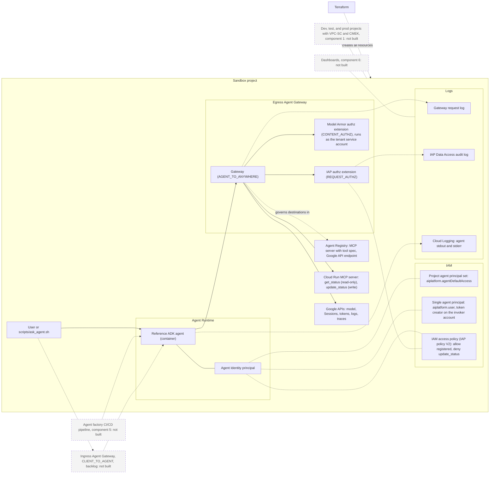
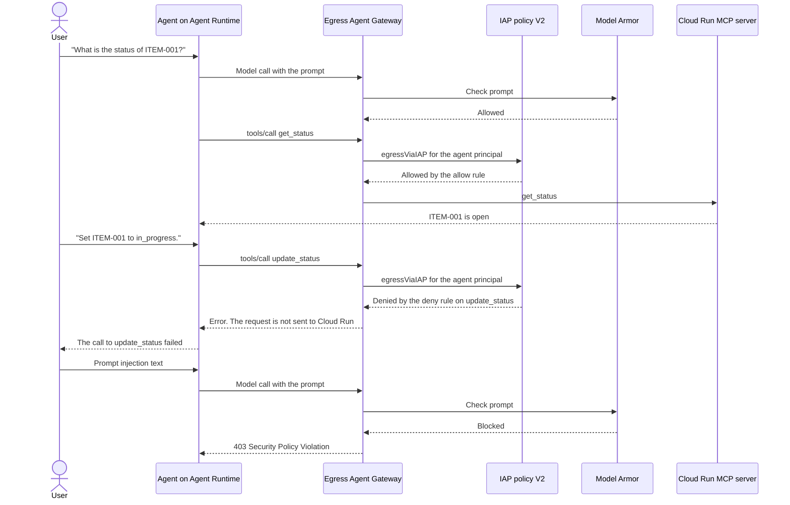

# GEAP starter pack

> [!NOTE]
> Draft. The scope is a proposal. It is not agreed.

The GEAP starter pack is the governed platform that a customer receives on handover day. Agents
from an agent factory run on it with the controls on: Agent Identity, Agent Registry, an egress
Agent Gateway, and audit logs.

This folder holds the **mini build**. The mini build proves the pattern in one sandbox project. The
product definition is in [conductor/product.md](conductor/product.md).

**Start here:** [GUIDE.md](GUIDE.md) is the step-by-step guide from an empty project to a working
mini build, with the known problems and their fixes.

## How it works

Terraform creates every resource in the diagram. The agent calls tools and Google APIs only through
the egress Agent Gateway. The gateway asks IAP and Model Armor for a decision on each call.



Legend: solid border = built in the mini build. Dashed border = not built.

The request flow below is in `ENFORCE` mode. The denied call never gets to Cloud Run.



## Layout

| Folder | What it holds | Component |
|---|---|---|
| [`terraform/`](terraform/) | APIs, audit logs, IAM, Cloud Run, Agent Registry, Agent Gateway, Model Armor, the agent | 1, 2, 3, 4 |
| [`agent-template/`](agent-template/) | The ADK reference agent | 4 |
| [`mcp-server/`](mcp-server/) | A sample MCP server in Go, with one read-only tool and one write tool | 3 |
| [`policies/`](policies/) | The IAP access policy and the Model Armor settings | 3 |
| [`pipelines/`](pipelines/) | Not built (component 5) | 5 |
| [`runbooks/`](runbooks/) | Add a new agent. Reset the demo | 6 |
| [`scripts/`](scripts/) | Package the agent, ask the agent, read the audit log, clean up | 6 |

## Related folders

These are links only. The starter pack does not use code from them.

- [`agent_auth`](../agent_auth/): the identity baseline and the 3LO auth provider pattern.
- [`curated_codelabs/agent-gateway-governance`](../curated_codelabs/agent-gateway-governance/): the
  egress gateway codelab with IAP policy V1.

## Deploy the mini build

Prerequisites: a sandbox project with billing, `gcloud`, Terraform 1.9 or later, and the Owner role
on the project. Use a dedicated project. The mini build uses `us-central1`.

```bash
cd geap_starter_pack
cp terraform/terraform.tfvars.example terraform/terraform.tfvars
# Edit terraform/terraform.tfvars: project_id, project_number, and organization_id.

gcloud auth application-default login
scripts/package_agent.sh

cd terraform
terraform init
terraform fmt -check -recursive && terraform validate && terraform test
terraform plan -out=tfplan
terraform apply tfplan
```

### Known prerequisite: domain restricted sharing

The gateway calls Model Armor as its Service Extensions service account. That account is in a
Google-managed tenant project. Terraform gives it 3 roles: `roles/modelarmor.calloutUser`,
`roles/modelarmor.user`, and `roles/serviceusage.serviceUsageConsumer`. If the organization enforces
`iam.allowedPolicyMemberDomains`, these 3 grants fail with "not in permitted organization". Without
them, Model Armor does not scan the gateway traffic.

The organization admin must choose one option before the apply:

| Option | Use |
|---|---|
| Option C: managed constraint `iam.managed.allowedPolicyMembers`, with `allowedMemberSubjects` that names the gateway Service Extensions account, in place of `iam.allowedPolicyMemberDomains` on the project | Production choice. **Not tested.** It is in the backlog in [product.md](conductor/product.md) |
| Option B: temporary project-level exception. Set `allow_google_managed_members = true`, apply the org policy and the 3 grants with `-target`, then set it to `false` and apply again. The grants remain. The grants failed for about 3 minutes after the exception was set | Used for the mini build |
| Project-level `allowAll` (`allow_google_managed_members = true` in this Terraform) | Sandbox only |

## Demo: identity, catalog, gateway control, audit (10 minutes)

Run [reset the demo](runbooks/reset_demo.md) before you start.

| Minute | Show | Command or page |
|---|---|---|
| 0 to 2 | **Identity.** The agent has its own Agent Identity principal. Tool access, Sessions, and the IAP policy apply to this single principal. Start-up base roles go to the project agent principal set. There is no project-level token creator role | `terraform output agent_principal`. IAM page of the project |
| 2 to 4 | **Catalog.** The MCP server and the Google API endpoints are in Agent Registry. The tool spec marks `get_status` as read-only | Agent Registry page. [`tool_spec.json`](mcp-server/tool_spec.json) |
| 4 to 7 | **Gateway control.** In `DRY_RUN`, ask "Set ITEM-003 to closed". The call passes. Change to `ENFORCE`, wait 3 minutes, and ask again. The call is denied. The agent can show "MCP session connection lost", not a clear `403` | `scripts/ask_agent.sh "Set ITEM-003 to closed"`. [`policies/iap_access_policy.yaml`](policies/iap_access_policy.yaml) |
| 7 to 10 | **Audit.** Known gap with IAP policy V2: the IAP Data Access audit log and the gateway request log did not show the dry-run result or the enforced denial. Show the evidence that exists: the agent error for `update_status`, and no matching request in the Cloud Run request log | Agent reply. `gcloud logging read` on `run.googleapis.com/requests`. `scripts/read_audit_log.sh 15m` for the logs that do appear |

The change to `ENFORCE` takes about 2 minutes to apply, and the gateway uses it 1 to 3 minutes
later. For a 10-minute demo, prepare a second terminal, or show the enforced result from an earlier
run.

> [!WARNING]
> Known gap (08 Nov 2026 test, IAP policy V2): the IAP Data Access audit log had entries only for
> MCP base methods (`initialize`, `notifications/initialized`). It had no entry for the `tools/call`
> decisions, including the enforced denial. The gateway request log also had no entry for the
> denied call. Show the denial in the agent reply until this gap is solved.

## Clean up

Keep the resources for customer demos. After the demos, run:

```bash
scripts/cleanup.sh
```

The script runs `terraform destroy` and deletes the Cloud Build source bucket. It deletes only the
mini build resources.
