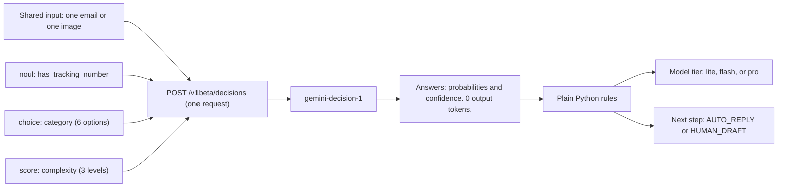
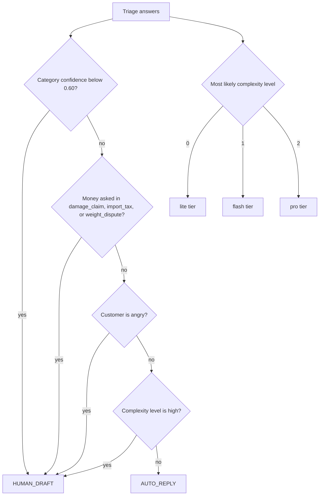
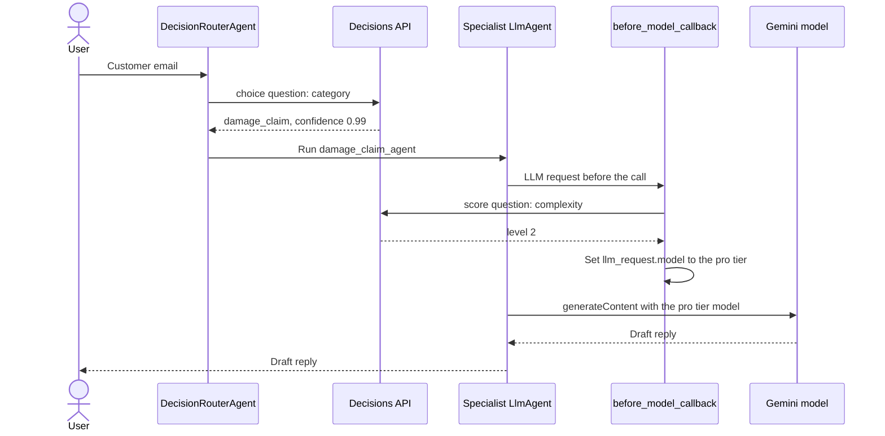
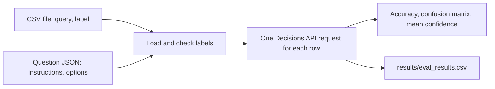
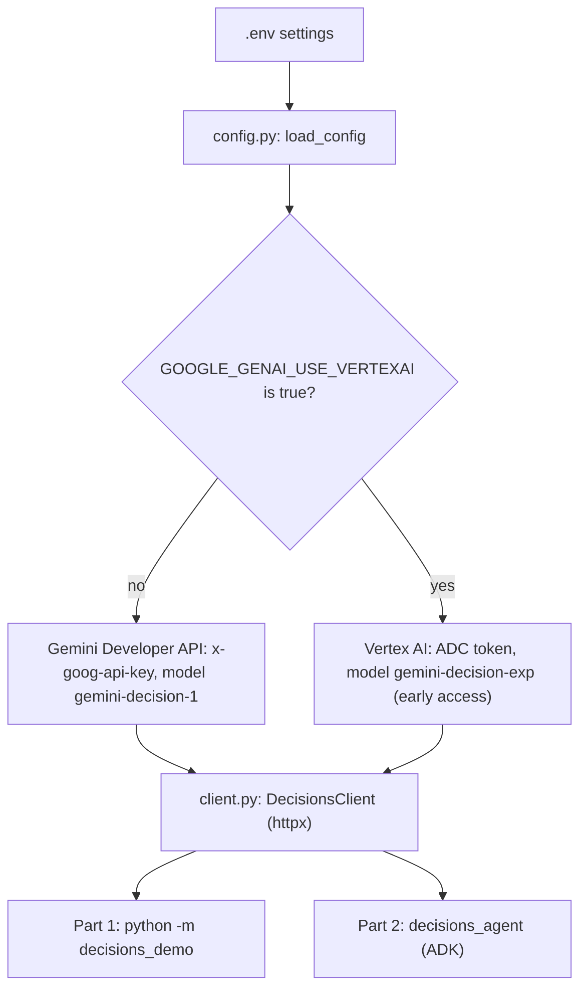
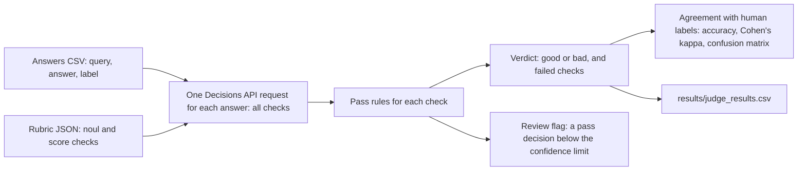

# Gemini Decisions API demo

This demo shows the Gemini Decisions API (`gemini-decision-1`). The API does not generate
text. It reads one shared input and returns calibrated probabilities for typed questions.
Your code then branches on the answers.

The demo has two parts:

- **Part 1: the raw API.** Command-line commands and a notebook for email triage, tool
  selection, multimodal input, evaluation, a rubric judge, and a comparison with
  `generateContent`.
- **Part 2: ADK.** An ADK agent that routes each email with the Decisions API, and a
  `before_model_callback` that selects the model tier for each turn.

The scenario is a fictional parcel-delivery company. All emails, images, and labels are
synthetic.

## Diagrams

### 1. One request, many typed questions

One request sends one shared input and many questions. The API returns numbers, not text.
Plain code then makes the decision.



### 2. Triage rules (`scenario.py`)

The rules use only the answers. A model does not make this decision.



### 3. ADK agent: router and model-tier callback

The Decisions API is called two times for each email: one time to route, and one time to
select the model tier.



### 4. Evaluation command



### 5. Backends and the REST client

The demo calls the REST endpoint with `httpx`, because `google-adk` 2.14.0 requires
`google-genai<3` and the SDK method `client.decisions.create` is only in `google-genai` 3.2.0.



## The three question types

| Type | Question | Answer |
|---|---|---|
| `noul` | Is a statement true? | `noul`: the probability of "yes" (0.01 to 0.99) |
| `choice` | Which option is the best? (2 to 255 options) | `choice` and `probabilities` for all options |
| `score` | Which level on an ordered rubric? (2 to 255 levels) | `score` (the expected level) and `probabilities` for each level |

One request can hold up to 1,000 questions about the same input. The API bills the shared
input one time for each request. The output is 0 tokens. The price is US$0.10 for each
1M input tokens (official pricing page, 12 Nov 2026).

## Setup

You need Python 3.11 or later and one of the two backends.

```bash
cd gemini_decisions_api
python3 -m venv .venv
source .venv/bin/activate
pip install -r requirements.txt
cp .env.example .env
```

Then set the backend in `.env`:

| Backend | Settings in `.env` | Status |
|---|---|---|
| Gemini Developer API (default) | `GEMINI_API_KEY` from Google AI Studio | Tested on 12 Nov 2026. |
| Vertex AI | `GOOGLE_GENAI_USE_VERTEXAI=true`, `GOOGLE_CLOUD_PROJECT`, `GOOGLE_CLOUD_LOCATION=global`, and `gcloud auth application-default login` | **Not tested.** The Decisions API on Vertex AI is in early access. The project must be on the allowlist. |

To confirm the setup, send one real request:

```bash
python scripts/check_api.py
```

## Part 1: commands

```bash
python -m decisions_demo triage       # Category, complexity, and checks for one email.
python -m decisions_demo tools        # Select the next tool for an agent.
python -m decisions_demo multimodal   # Several questions about one synthetic image.
python -m decisions_demo eval         # Accuracy on data/sample_emails.csv.
python -m decisions_demo judge        # Grade answers with a rubric. See "Judge" below.
python -m decisions_demo compare      # Same questions through generateContent.
```

`triage` and `tools` accept `--email "<text>"`. Each command prints three blocks: the
input, the answers, and the decision.

### Evaluation with your own data

Give a CSV file with the columns `query` and `label`, and a question file:

```bash
python -m decisions_demo eval --dataset my_data.csv --question my_question.json
```

```json
{"instructions": "Which queue must handle this message?",
 "options": {"billing": "Payment questions.", "tracking": "Where is my parcel."}}
```

Every label must be an option key. The command stops with the row number if a label is
not an option key. It prints accuracy, a confusion matrix, and the mean confidence for
correct and incorrect rows. It writes all rows to `results/eval_results.csv`.

### Notebook

`notebooks/decisions_api_demo.ipynb` explains each use case step by step.

## Judge: grade answers with a rubric

The `judge` command grades text answers from any system: this demo's ADK agent, Gemini
Enterprise, or another agent. Each answer gets one Decisions API request with all rubric
checks. The command then compares the verdicts with human labels.

```bash
python -m decisions_demo judge
python -m decisions_demo judge --answers my_answers.csv --rubric my_rubric.json --min-confidence 0.7
```



### Answers file (CSV)

| Column | Required | Content |
|---|---|---|
| `query` | yes | The question that the system answered. |
| `answer` | yes | The answer to grade. |
| `label` | yes | The human label: `good` or `bad`. |
| `check:<key>` | no | A human label for one check: `yes` if the check passes, `no` if it fails. The command then reports the agreement for that check. |

### Rubric file (JSON)

```json
{"checks": [
  {"key": "answers_the_query", "type": "noul",
   "instructions": "The answer addresses the topic of the customer query.", "pass_when": true},
  {"key": "promises_money", "type": "noul",
   "instructions": "The answer promises a refund before any review.", "pass_when": false},
  {"key": "tone", "type": "score", "instructions": "Rate the tone of the answer.",
   "levels": ["Rude.", "Neutral.", "Polite."], "min_level": 1}
]}
```

- An answer is `good` when every check passes.
- A `noul` check passes when the answer equals `pass_when`.
- A `score` check passes when the most likely level is `min_level` or higher.
- A row is marked for review when the probability of a pass or fail decision is below
  `--min-confidence`. For a `score` check, the probabilities of all passing levels are
  added. Thus a split between "Neutral" and "Polite" does not cause a review.

### Sample data and result (12 Nov 2026)

`data/judge_answers.csv` has 20 synthetic answers: 10 good, and 10 with one planted defect
each (wrong topic, money promise, wrong tracking number, no next step, rude tone).

| Measure | Result |
|---|---|
| Verdict accuracy | 20 of 20 (100 percent) |
| Cohen's kappa | 1.00 |
| Agreement for each check | 90 to 100 percent. `gives_next_step` 18 of 20, `answers_the_query` 19 of 20. |
| Rows for review | 3 of 20 |
| Tokens and cost | 8,020 input tokens, 0 output tokens, about US$0.0008 |

The planted defects are clear, so this result is not a benchmark. Use your own labeled
answers to measure the judge on real work.

### Limits of the judge

- **No reasons.** The judge gives probabilities, not explanations. Use an LLM judge for rows
  where you need the reason.
- **Human labels are still necessary.** A judge must be checked against a set of answers that
  people labeled. The judge makes grading cheaper. It does not remove the labeled set.
- **Input formats.** The Decisions API accepts text, images, audio, video, and PDF. Convert
  other files first.

## Part 2: the ADK agent

```bash
adk web      # Then open the URL and select decisions_agent.
adk run decisions_agent
```

| Part | What it does |
|---|---|
| `DecisionRouterAgent` | Asks one `choice` question and sends the email to one of six specialist agents. The routing is plain code, not an LLM transfer. |
| `before_model_callback` | Asks one `score` question about complexity and sets `llm_request.model` to the lite, flash, or pro tier. |

The session state shows `category`, `routed_to`, `model_tier`, and `complexity_score`.

## Results on 12 Nov 2026

These numbers come from single runs from Singapore. They are not benchmarks.

| Run | Result |
|---|---|
| `triage` (6 questions) | 543 input tokens, 0 output tokens, 399 ms |
| `multimodal` (4 questions, 1 image) | 1,375 input tokens, 1,171 ms |
| `eval` (24 synthetic emails) | 24 of 24 correct, mean confidence 0.99. The emails are easy. |
| `compare` | Decisions API 396 ms. `gemini-3.5-flash-lite` 46,122 ms in the first run and 5,846 ms in a second run (the service was slow that day). 5 of 6 answers agreed. |
| ADK agent | Routed a damage claim to `damage_claim_agent` and selected the pro tier. |

## Cost

Measured on 12 Nov 2026 with the Gemini Developer API paid tier. Prices come from the
official pricing page on that date: `gemini-decision-1` costs US$0.10 for each 1M input
tokens, with no output cost. `gemini-3.5-flash-lite` costs US$0.30 for each 1M input
tokens and US$2.50 for each 1M output tokens.

| Command | Input tokens | Output tokens | Cost (US$) |
|---|---|---|---|
| `triage` | 543 | 0 | 0.00005 |
| `tools` | 302 | 0 | 0.00003 |
| `multimodal` | 1,375 | 0 | 0.00014 |
| `eval` (24 rows) | 4,876 | 0 | 0.00049 |
| `judge` (20 answers) | 8,020 | 0 | 0.00080 |
| `compare`: Decisions API part | 543 | 0 | 0.00005 |
| `compare`: `generateContent` part | 333 | 60 | 0.00025 |
| Full build and test of this demo | about 49,000 (Decisions API) | small | about 0.006 |

The real charge for your key is on the AI Studio usage page. Token counts change when you
change the input text or the questions.

## Known limits

- **REST, not the SDK.** `google-genai` 3.2.0 has `client.decisions.create`, but
  `google-adk` 2.14.0 requires `google-genai<3`. Thus the demo calls the REST endpoint
  with `httpx` (`src/decisions_demo/client.py`). Change to the SDK when ADK accepts
  `google-genai` 3.x.
- **Tier models.** The defaults are `gemini-3.5-flash-lite`, `gemini-3.8-flash`, and
  `gemini-4-argon`. On 12 Nov 2026, the flash and pro models returned `504`, so the ADK
  test used `MODEL_TIER_FLASH` and `MODEL_TIER_PRO` overrides in `.env`. You can set
  these overrides for any model.
- **Vertex AI** is not tested.
- **`include_none_of_above`** is not in the official documentation. The `tools` command
  adds a `none` option as a normal option.

## Tests

```bash
pytest                    # Unit tests. No network.
pytest -m integration     # Real ADK run. Needs a key in .env.
ruff check .
```
