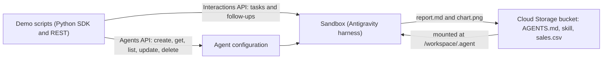

# Managed Agents API demo

> [!WARNING]
> The Managed Agents API on Gemini Enterprise Agent Platform is a **Pre-GA (Preview)** product.
> Do not use proprietary, sensitive, or confidential data with it. This demo uses only
> synthetic data. Model use is billed at standard rates.

This demo builds a data analyst agent with the
[Managed Agents API](https://docs.cloud.google.com/gemini-enterprise-agent-platform/build/managed-agents).
You do not write agent code. You send a configuration to the **Agents API**, and Google runs
the agent in an isolated sandbox with the Antigravity harness. Then you send tasks to the agent
with the **Interactions API**.

The agent reads a synthetic sales CSV file from a Cloud Storage bucket, runs Python in its
sandbox, and writes a Markdown report and a PNG chart back to the bucket.



## What the demo shows

| Feature | Script | API |
|---|---|---|
| Access check: create and delete one agent, with the long-running operation | `scripts/00_access_check.py` | REST |
| Demo bucket with `AGENTS.md`, one skill, and the data | `scripts/00b_setup_bucket.py` | Cloud Storage |
| Agent lifecycle: create, get, list, update | `scripts/01_lifecycle.py` | REST and SDK |
| One task: analyse the data, write a chart and a report | `scripts/02_interact.py` | SDK |
| Multi-turn session in the same sandbox | `scripts/03_session.py` | SDK |
| Tool override for one interaction (adds Google Search) | `scripts/04_override.py` | SDK |
| Cleanup of the demo agents and the bucket | `scripts/99_cleanup.py` | REST and SDK |
| The same calls with `curl` | `scripts/rest_reference.sh` | REST |
| All steps in one place | `notebook.ipynb` | SDK and REST |

## Before you start

- A Google Cloud project with billing and the Vertex AI API (`aiplatform.googleapis.com`).
- Permission to create agents and a Cloud Storage bucket in the project. The demo was tested
  with an organization administrator account. The smallest role set is not confirmed yet.
- `gcloud`, signed in with `gcloud auth application-default login`.
- Python 3.11 or later.

## Setup

```bash
cd managed_agents_api
python3 -m venv .venv
.venv/bin/pip install -r requirements-dev.txt
.venv/bin/pip install --no-build-isolation -e .
cp .env.example .env        # Then set GOOGLE_CLOUD_PROJECT.
```

## Run the demo

Run the scripts in this order. Scripts 02 to 04 use the agent that script 01 creates.

```bash
.venv/bin/python scripts/00_access_check.py   # Optional. The first agent in a project can take 3 to 6 minutes.
.venv/bin/python scripts/00b_setup_bucket.py
.venv/bin/python scripts/01_lifecycle.py
.venv/bin/python scripts/02_interact.py       # About 4 minutes.
.venv/bin/python scripts/03_session.py
.venv/bin/python scripts/04_override.py
.venv/bin/python scripts/99_cleanup.py --bucket
```

After script 02, open the bucket folder `agent/output/` in the Cloud console to see the report
and the chart. The script prints the link.

## Results from a test run (12 Nov 2026)

| Step | Result |
|---|---|
| First agent in a new project | 373 s to provision. The docs say two to three minutes. |
| Next agents | 13 s to provision. |
| Analysis task (script 02) | 231 s, 16 tool calls, about 235,000 tokens. The agent installed pandas and matplotlib, then wrote `report.md` and a PNG chart. Its numbers agreed with an independent calculation. |
| Follow-up (script 03) | 11 s, no tool calls. The agent answered from the first turn. |
| Tool override (script 04) | The agent used Google Search for one turn. The stored agent did not change. |

The token count of script 02 is the largest cost of the demo. Check the
[pricing page](https://cloud.google.com/gemini-enterprise-agent-platform/generative-ai/pricing)
before you run it many times.

## Preview limits found while building the demo

These limits are true for the API on 12 Nov 2026. They can change.

- **Sources.** The API accepts only `gcs` and `skill_registry` sources. The SDK type also lists
  `inline` and `repository`, but the API rejects them with HTTP 400.
- **Network.** An agent with a data source must have a network allowlist, and the only accepted
  domain is `*`. Thus the sandbox can reach all internet hosts. The lifecycle script prints a
  warning. Use only data that is safe to expose.
- **Mount target.** The target must be inside `/workspace`. The target `/.agent` passes the create
  call, but the mount fails in the sandbox. The demo uses `.agent`, so the files are in
  `/workspace/.agent`.
- **Write back.** Files that the agent writes under the mount appear in the bucket.
- **SDK.** The Python SDK has no `update` method. The demo sends `PATCH` with `update_mask`. The SDK
  `create` and `delete` methods hide the long-running operation, so the demo uses REST for them.
- **Interaction tools.** The `tools` field of an interaction does not accept `filesystem`. A tool
  override with only `code_execution` did not remove the harness file tools.
- **Google Search.** Search results do not come as a separate step in the stream. They come as
  `url_citation` annotations on the agent text.
- **Agent identity.** Each agent has its own identity (`effectiveIdentity`). IAM bindings to that
  identity remain after the agent is deleted. The cleanup script prints a notice.
- **Console.** The Cloud console does not show these agents or their interactions. Cloud Audit
  Logs showed no entries for the agent calls during the test.

## Project layout

```text
managed_agents_api/
├── assets/                  # AGENTS.md and the report-writer skill. Uploaded to the bucket.
├── scripts/                 # Thin scripts. One for each step.
├── src/managed_agents_demo/ # The code that the scripts and the notebook use.
├── tests/                   # Unit tests. They do not call the network.
├── notebook.ipynb
└── conductor/               # The spec, the plan, and the decision log for this demo.
```

## Tests

```bash
.venv/bin/pytest                                   # Unit tests. No network.
RUN_INTEGRATION=1 .venv/bin/pytest -m integration  # Real API. Creates an agent, then deletes it.
.venv/bin/ruff check .
```

## Not built

- Download of the output files to the local disk.
- A bucket in another project.
- MCP server tools (for example the BigQuery MCP server).
- Skills from the Skill Registry.
- Evaluation with the GenAI Evaluation Service.
- A web UI.
