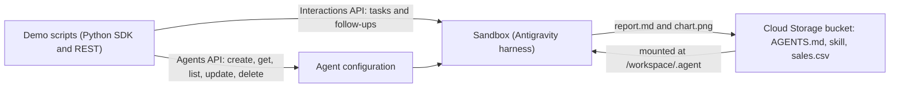
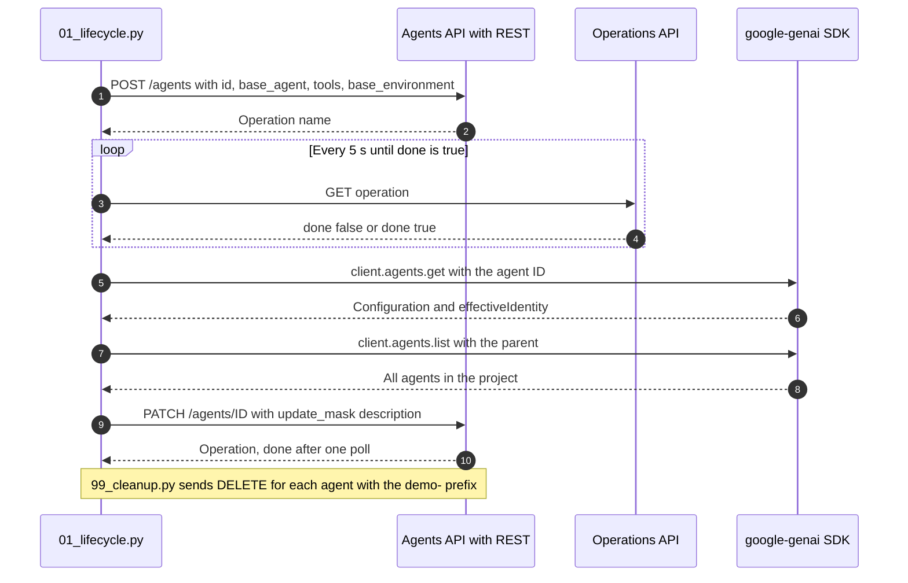
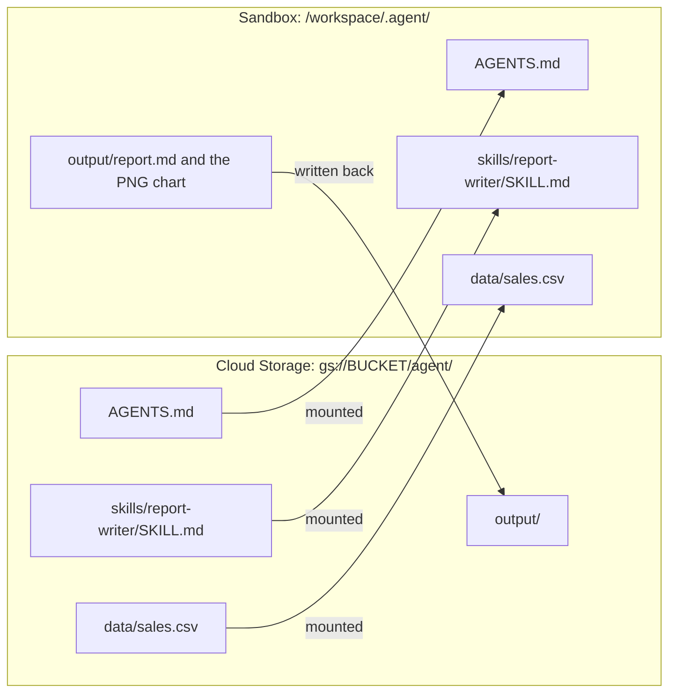
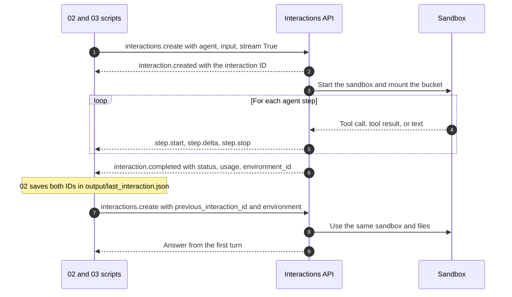
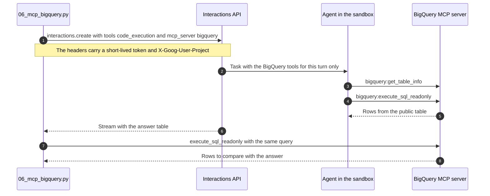
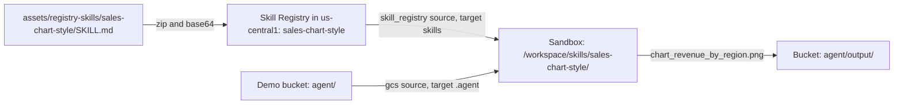
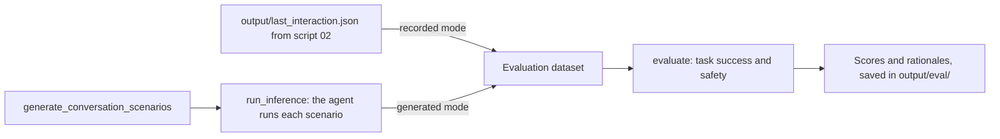
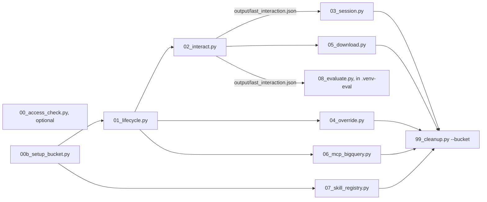
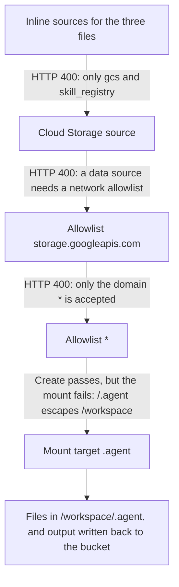

# Managed Agents API demo

> [!WARNING]
> The Managed Agents API on Gemini Enterprise Agent Platform is a **Pre-GA (Preview)** product.
> Do not use proprietary, sensitive, or confidential data with it. This demo uses only
> synthetic data. Model use is billed at standard rates.

This demo builds a data analyst agent with the
[Managed Agents API](https://docs.cloud.google.com/gemini-enterprise-agent-platform/build/managed-agents).
You do not write agent code. You send a configuration to the **Agents API**, and Google runs
the agent in an isolated sandbox with the Antigravity harness. Then you send tasks to the agent
with the **Interactions API**.

The agent reads a synthetic sales CSV file from a Cloud Storage bucket, runs Python in its
sandbox, and writes a Markdown report and a PNG chart back to the bucket.



## What the demo shows

| Feature | Script | API |
|---|---|---|
| Access check: create and delete one agent, with the long-running operation | `scripts/00_access_check.py` | REST |
| Demo bucket with `AGENTS.md`, one skill, and the data | `scripts/00b_setup_bucket.py` | Cloud Storage |
| Agent lifecycle: create, get, list, update | `scripts/01_lifecycle.py` | REST and SDK |
| One task: analyse the data, write a chart and a report | `scripts/02_interact.py` | SDK |
| Multi-turn session in the same sandbox | `scripts/03_session.py` | SDK |
| Tool override for one interaction (adds Google Search) | `scripts/04_override.py` | SDK |
| Download of the report and the chart | `scripts/05_download.py` | Cloud Storage |
| BigQuery MCP server for one interaction | `scripts/06_mcp_bigquery.py` | SDK and MCP |
| A skill from Skill Registry in a second agent | `scripts/07_skill_registry.py` | REST and SDK |
| Evaluation with the GenAI Evaluation Service | `scripts/08_evaluate.py` | Evaluation SDK |
| Cleanup of the demo agents and the bucket | `scripts/99_cleanup.py` | REST and SDK |
| The same calls with `curl` | `scripts/rest_reference.sh` | REST |
| A local web UI: stream a task and see the outputs | `webui/` (Go and TypeScript) | REST and Cloud Storage |
| All steps in one place | `notebook.ipynb` | SDK and REST |

## How it works

### Agent lifecycle

The Agents API is the control plane. Create, update, and delete return a long-running operation.
The demo sends these calls with REST, so that you can see the operation. It reads agents with the
SDK.



### Bucket and sandbox

The API accepts only Cloud Storage and Skill Registry sources. The demo uploads three files under
the `agent/` prefix. The agent mounts the prefix at `.agent`, which is `/workspace/.agent` in the
sandbox. Files that the agent writes under the mount go back to the bucket.



### Interactions and sessions

The Interactions API is the data plane. The reply is an event stream. The last event gives the
interaction ID and the environment ID. The next turn sends both IDs, so the agent keeps the
conversation and the sandbox files.



### BigQuery MCP server for one interaction

Script 06 adds the Google-hosted BigQuery MCP server (`https://bigquery.googleapis.com/mcp`) to
one interaction. The access token goes in the `tools` override of that request only. It is not
stored in the agent configuration, and the terminal output masks it. The MCP tool calls come
as steps named `bigquery:<tool>`. Then the script runs the same query directly with the MCP
tool `execute_sql_readonly`, and checks the agent answer.



### Skill from Skill Registry

Script 07 zips `assets/registry-skills/sales-chart-style/` and publishes it to Skill Registry.
Skill Registry is regional (`us-central1`). The script then creates a second agent,
`demo-skill-analyst`, with two sources: the demo bucket and the registry skill. The skill sets
a chart style and a file name rule (`chart_<metric>_by_<category>.png`). The script checks the
file name in the bucket to prove that the agent used the skill.



A skill ID stays reserved after you delete the skill. `scripts/99_cleanup.py --skills` deletes
the skill, but a new skill cannot use the same ID.

### Evaluation

Script 08 uses the GenAI Evaluation Service, as the Managed Agents evaluation guide describes.
It has two modes:

- **Recorded** (default): score the interaction that script 02 saved.
- **Generated** (`--generate N`): generate N scenarios from the agent configuration, run the agent
  on them, and score the conversations. This mode runs the agent, so it costs more.

For managed agents, the SDK accepts only three metrics: `multi_turn_task_success_v1`,
`final_response_quality_v1`, and `safety_v1`. The demo uses task success and safety.
`final_response_quality_v1` failed in the test, because its default judge model
(`gemini-2.5-pro` in `global`) was "not found".

The evaluation SDK needs `google-genai` < 3, and the demo uses 3.2.0. Thus the evaluation runs
in a second virtual environment:

```bash
python3 -m venv .venv-eval
.venv-eval/bin/pip install -r requirements-eval.txt
.venv-eval/bin/pip install --no-deps --no-build-isolation -e .
.venv-eval/bin/python scripts/08_evaluate.py                # Recorded mode.
.venv-eval/bin/python scripts/08_evaluate.py --generate 1   # Generated mode, one scenario.
```



## Before you start

- A Google Cloud project with billing and the Vertex AI API (`aiplatform.googleapis.com`).
- Permission to create agents and a Cloud Storage bucket in the project. The demo was tested
  with an organization administrator account. The smallest role set is not confirmed yet.
- `gcloud`, signed in with `gcloud auth application-default login`.
- Python 3.11 or later.

## Setup

```bash
cd managed_agents_api
python3 -m venv .venv
.venv/bin/pip install -r requirements-dev.txt
.venv/bin/pip install --no-build-isolation -e .
cp .env.example .env        # Then set GOOGLE_CLOUD_PROJECT.
```

## Run the demo

Run the scripts in this order. Scripts 02 to 04 use the agent that script 01 creates.



```bash
.venv/bin/python scripts/00_access_check.py   # Optional. The first agent in a project can take 3 to 6 minutes.
.venv/bin/python scripts/00b_setup_bucket.py
.venv/bin/python scripts/01_lifecycle.py
.venv/bin/python scripts/02_interact.py       # About 4 minutes.
.venv/bin/python scripts/03_session.py
.venv/bin/python scripts/04_override.py
.venv/bin/python scripts/05_download.py       # Report and chart to output/agent/.
.venv/bin/python scripts/06_mcp_bigquery.py   # Needs BigQuery job and MCP tool permissions.
.venv/bin/python scripts/07_skill_registry.py # Publishes a skill and creates a second agent.
.venv-eval/bin/python scripts/08_evaluate.py  # Scores the interaction from step 02. See "Evaluation".
.venv/bin/python scripts/99_cleanup.py --bucket --skills
```

After script 02, open the bucket folder `agent/output/` in the Cloud console to see the report
and the chart. The script prints the link.

## Web UI

`webui/` has a small local web UI: a Go backend and a TypeScript frontend. Select an agent, send
a task, see the tool calls and the text as they stream, continue the session, and open the report
and the chart from the bucket. The Go server holds the credentials, so the browser never gets a
token. See [webui/README.md](webui/README.md).

```bash
cd webui
(cd web && npx -y -p typescript@5.9.3 tsc -p .)
cd server && GOOGLE_CLOUD_PROJECT=your-project-id go run .   # Then open http://localhost:8080
```

## Results from a test run (12 Nov 2026)

| Step | Result |
|---|---|
| First agent in a new project | 373 s to provision. The docs say two to three minutes. |
| Next agents | 13 s to provision. |
| Analysis task (script 02) | 231 s, 16 tool calls, about 235,000 tokens. The agent installed pandas and matplotlib, then wrote `report.md` and a PNG chart. Its numbers agreed with an independent calculation. |
| Follow-up (script 03) | 11 s, no tool calls. The agent answered from the first turn. |
| Tool override (script 04) | The agent used Google Search for one turn. The stored agent did not change. |
| Web UI (13 Nov 2026) | A real task streamed through the Go server to a headless browser: 11 tool calls, then the answer "South, 488,846.67", which agrees with an independent calculation. |
| Skill Registry (script 07, 13 Nov 2026) | The skill became `ACTIVE`. The agent read `/workspace/skills/sales-chart-style/SKILL.md` and wrote `chart_revenue_by_region.png`, as the skill requires. |
| BigQuery MCP (script 06, 13 Nov 2026) | The agent called `bigquery:get_table_info` and `bigquery:execute_sql_readonly`. Its top 3 names (Liam 19,777, Noah 18,630, Olivia 17,641) agreed with the direct query. |

The token count of script 02 is the largest cost of the demo. Check the
[pricing page](https://cloud.google.com/gemini-enterprise-agent-platform/generative-ai/pricing)
before you run it many times.

## Preview limits found while building the demo

These limits are true for the API on 12 Nov 2026. They can change.

The first design used inline files. Each HTTP 400 error below changed the design, until the
agent could read and write its files.



- **Sources.** The API accepts only `gcs` and `skill_registry` sources. The SDK type also lists
  `inline` and `repository`, but the API rejects them with HTTP 400.
- **Network.** An agent with a data source must have a network allowlist, and the only accepted
  domain is `*`. Thus the sandbox can reach all internet hosts. The lifecycle script prints a
  warning. Use only data that is safe to expose.
- **Mount target.** The target must be inside `/workspace`. The target `/.agent` passes the create
  call, but the mount fails in the sandbox. The demo uses `.agent`, so the files are in
  `/workspace/.agent`.
- **Write back.** Files that the agent writes under the mount appear in the bucket.
- **SDK.** The Python SDK has no `update` method. The demo sends `PATCH` with `update_mask`. The SDK
  `create` and `delete` methods hide the long-running operation, so the demo uses REST for them.
- **Interaction tools.** The `tools` field of an interaction does not accept `filesystem`. A tool
  override with only `code_execution` did not remove the harness file tools.
- **Google Search.** Search results do not come as a separate step in the stream. They come as
  `url_citation` annotations on the agent text.
- **Agent identity.** Each agent has its own identity (`effectiveIdentity`). IAM bindings to that
  identity remain after the agent is deleted. The cleanup script prints a notice.
- **MCP tools.** MCP calls come as `function_call` steps named `<server>:<tool>`, for example
  `bigquery:execute_sql_readonly`. A `tools` override replaces all agent tools for that turn, so
  script 06 also sends `code_execution`.
- **Skill Registry.** Skill Registry is regional, and the agent is global. A `skill_registry`
  source with the target `skills` puts the skill in `/workspace/skills/<skill-id>/`. A skill ID
  stays reserved after a delete. Both agents write to the same bucket folder, so a later run can
  replace an earlier `report.md`.
- **Console.** The Cloud console does not show these agents or their interactions. Cloud Audit
  Logs showed no entries for the agent calls during the test.

## Project layout

```text
managed_agents_api/
├── assets/                  # AGENTS.md and the report-writer skill. Uploaded to the bucket.
├── scripts/                 # Thin scripts. One for each step.
├── src/managed_agents_demo/ # The code that the scripts and the notebook use.
├── tests/                   # Unit tests. They do not call the network.
├── webui/                   # Go backend and TypeScript frontend for a local web UI.
├── notebook.ipynb
└── conductor/               # The spec, the plan, and the decision log for this demo.
```

## Tests

```bash
.venv/bin/pytest                                   # Unit tests. No network.
RUN_INTEGRATION=1 .venv/bin/pytest -m integration  # Real API. Creates an agent, then deletes it.
.venv/bin/ruff check .
```

## Not built

- A bucket in another project.
- MCP servers other than BigQuery.
