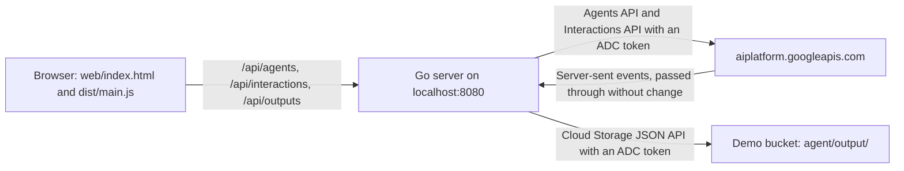

# Web UI for the Managed Agents API demo

A small local web UI. It shows the same flow as the scripts: select an agent, send a task, see
the agent steps and text as they stream, and see the report and the chart from the bucket.

| Part | Language | Folder |
|---|---|---|
| Backend | Go, standard library and `golang.org/x/oauth2/google` | `server/` |
| Frontend | TypeScript, no framework, compiled with `tsc` | `web/` |



The server holds the Google credentials. The browser never gets a token. The file endpoint
returns only objects under `agent/output/`.

## Before you start

- Run the Python setup in `../README.md`, then `scripts/00b_setup_bucket.py` and
  `scripts/01_lifecycle.py`, so that the bucket and an agent exist.
- Go 1.24 or later, and Node.js (only for `npx tsc`).
- `gcloud auth application-default login`.

## Run

```bash
cd managed_agents_api/webui
(cd web && npx -y -p typescript@5.9.3 tsc -p .)
cd server
GOOGLE_CLOUD_PROJECT=your-project-id go run .
```

Open http://localhost:8080. Optional settings: `DEMO_BUCKET` (default
`<project-id>-managed-agents-demo`), `PORT` (default `8080`), and `STATIC_DIR` (default `../web`).

## API

| Method and path | What it does |
|---|---|
| `GET /api/config` | The project ID and the bucket name. |
| `GET /api/agents` | The agents in the project (ID and description). |
| `POST /api/interactions` | Body: `agent`, `input`, and optional `previousInteractionId` and `environmentId`. Returns the event stream. |
| `GET /api/outputs` | The files under `agent/output/` in the bucket. |
| `GET /api/outputs/file?name=agent/output/<file>` | One output file. |

## Test

```bash
cd server && go vet ./... && go test ./...
cd ../web && npx -y -p typescript@5.9.3 tsc -p . && node --test test/sse.test.mjs
```

## Container

`Dockerfile` builds the frontend with Node.js, the server with Go, and runs on
`gcr.io/distroless/static:nonroot`. The container needs Google credentials, for example a mounted
ADC file for a local run, or a service account on Cloud Run. Cloud Run deployment is not part of
this demo.
